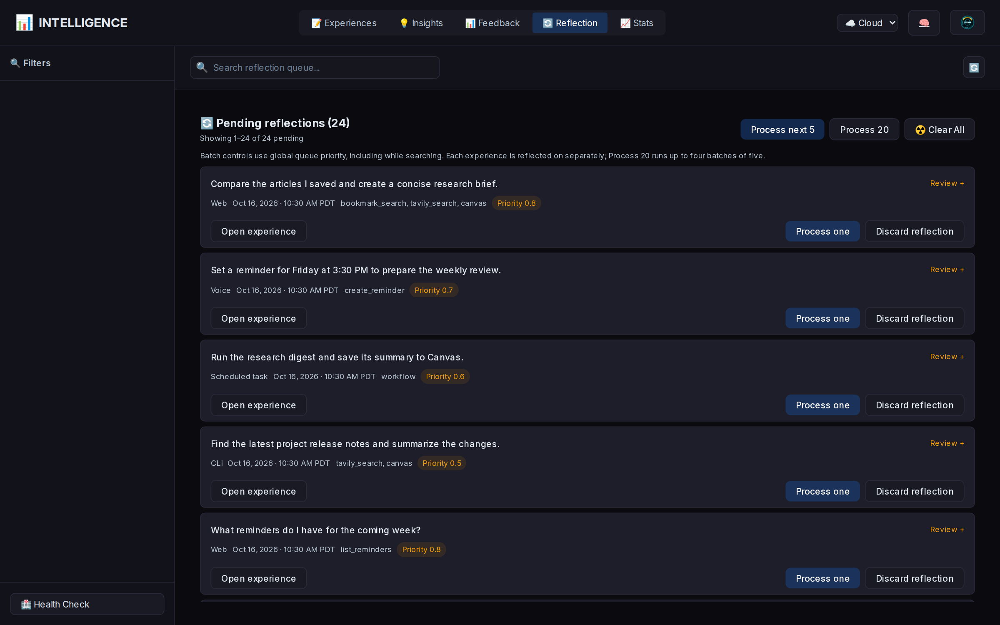

# Jarvis Intelligence Layer

Intelligence records eligible Jarvis interactions and learns reusable guidance
for later requests. Use its dashboard to inspect experiences, review pending
reflections, manage learned insights, and check learning health.

## Overview

The Intelligence Layer is Jarvis's self-learning system. It observes interactions, reflects on what worked and what didn't, and applies learned insights to improve future routing decisions.


See the [Intelligence Layer infographic](images/intelligence-info-graph.jpeg) for the learning architecture.

**Key principles:**

- Semantic similarity finds candidate lessons; confidence and applicability checks decide which can influence a request.
- Positive guidance recommends approaches, while negative guidance identifies approaches to avoid in a specific context.
- Procedural lessons belong here; factual memory has a [separate system](MEMORY_SYSTEM.md).
- Reflection is on demand. Recording an experience does not immediately call a reflection model or guarantee that an insight will be created.

---

## Quick Start

Start the dashboard from the repository root:

```bash
./bin/jarvis-intelligence         # Cloud/default mode
./bin/jarvis-intelligence local   # Local mode
```

Open `http://localhost:5003`. Select **Experiences** to inspect recorded requests,
**Reflection** to review or process the pending queue, and **Insights** to inspect
what Jarvis learned. Each reflection is a separate model request and uses the
configured provider; review the queue before processing test or sensitive tasks.

### Default and Emergency Opt-Out

Intelligence is a core feature and is enabled by default. No cloud/local env
declaration is required. To disable it temporarily for testing or recovery:

```bash
JARVIS_INTELLIGENCE=false
```

When disabled:
- No experiences are recorded
- No insights are applied to routing
- Jarvis works normally (just without learning)
- Database remains intact for when re-enabled

### Check Status

```bash
# Run from the repository root with the development environment.
.venv/bin/python -c "
from lib.intelligence import get_intelligence_layer
import json
print(json.dumps(get_intelligence_layer().get_stats(), indent=2))
"
```

---

## Learning capabilities

### Positive & Negative Constraints

Insights describe approaches to prefer and approaches to avoid:

```
=== LEARNED STRATEGIES (WHAT TO DO) ===
✅ Use mcp_fetch_fetch for real-time server status queries
   → Applies to: System and server health check queries

=== KNOWN FAILURES - AVOID THESE ===
⚠️  These approaches have FAILED in the past:
❌ Avoid search_memory for current Bitcoin prices due to stale data.
   → DO NOT use: search_memory
   → Why: search_memory provided outdated data, leading to retry

=== TOOL PREFERENCES ===
  ✅ PREFER: mcp_fetch_fetch (+0.64)
  ❌ AVOID: search_memory (-0.31)
```

### Fact vs Procedural Classification

Reflection classifies candidate lessons:
- **Factual** (e.g., "Server IP is 10.0.0.1") → Not stored as an Intelligence insight; use the memory tools to save facts
- **Procedural** (e.g., "Use fetch for status queries") → Stored in Intelligence DB

### Generalizability Filtering

Insights are scored for generalizability:
- **High**: "Always use crypto_price for price queries" → Stored
- **Medium**: "Use X for Y in context Z" → Stored with lower weight
- **Low**: "The weather was rainy today" → NOT stored (too specific)

### Insight usage and confidence

Insight health fields update as guidance is applied and outcomes are recorded:
- `times_applied` - How often this insight is used
- `times_helpful` - Success count when applied
- `times_failed` - Failure count when applied
- `consecutive_failures` - Rapid decay trigger
- `last_outcome` - Most recent result (`success` / `failure` / `unused`)

### Feedback → Intelligence Bridge

Optional LLM feedback enriches the recorded experience and can correct its outcome:

```
Flow:
1. Experience recorded with outcome_success = True (default)
2. Feedback LLM grades the interaction (rating 1-5)
3. All ratings store compact feedback metadata in raw_data.feedback.latest
4. If rating ≤ 2: Experience CORRECTED to outcome_success = False
5. Reflection queue priority bumped to 0.8 (high) for failures

Rating Logic:
- Rating 4-5 → Marks user_satisfied when no hard Completion Guard failure exists
- Rating 3   → Ambiguous (left as-is)
- Rating 1-2 → FAILURE (retroactively corrected)
```

Feedback evaluates whether the answer completed the task, rather than relying
only on a tool’s `ok` flag. Low ratings can mark an experience as failed even
when the tools ran successfully.

Feedback is stored alongside, not instead of, Completion Guard metadata:

```json
{
  "feedback": {
    "latest": {
      "rating": 2,
      "summary": "The answer did not provide requested locations and hours.",
      "issues": [{"category": "other", "description": "Missing requested fields"}],
      "tool_ratings": {"serpapi_yelp_search": {"rating": 3}},
      "completion_guard_status": "auto_accepted",
      "updated_at": "2026-04-18T04:30:34"
    },
    "history": []
  }
}
```

The bridge is conservative around Completion Guard:

- Low feedback (`1-2`) can still downgrade a settled answer to failed.
- High feedback (`4-5`) can mark satisfaction but does not erase `had_to_retry`, repaired status, or Completion Guard notes.
- Hard guard outcomes (`unresolved`, `ticket_created`, `error`) are not softened by later high feedback.

### Completion Guard → Intelligence Bridge

When Jarvis Web runs [Completion Guard](./COMPLETION_GUARD.md), outcomes are written back onto the **same** experience row (no duplicate “repair-only” experiences). `lib/intelligence_hooks.py` provides `update_experience_from_completion_guard()`:

- **`accepted` / `auto_accepted`**: treat the user as satisfied with the settled answer.
- **`repaired`**: count as eventual success with `had_to_retry` and fold corrected speech, tools, and tool results into `raw_data` for reflection (compare first pass vs fix); bumps reflection queue priority (0.85).
- **`unresolved` / `ticket_created` / `error`**: mark failure for learning; higher reflection priority (0.95). **`cancelled`** uses a medium bump (0.7).
- **`expired` / `superseded`**: record neutral manual prompt settlement metadata on the original experience without changing success, satisfaction, retry flags, or reflection priority.

Explicit feedback collection in Web UI is **gated** until guard settlement so grades align with this record. Orchestrator-side random feedback sampling is temporarily disabled while Web Completion Guard is active to avoid pre-collected random feedback racing the guard state. See also [FEEDBACK_SYSTEM.md](./FEEDBACK_SYSTEM.md).

### Tool Trace + Argument Recovery in Reflection

Experience context stores a sanitized `tool_trace` so reflection can inspect attempted tool calls, not just final tool names.

Captured per attempt:

- tool name
- sanitized arguments
- success/failure
- duration
- short error/speech preview

Sensitive keys such as `api_key`, `authorization`, `password`, `secret`, and `token` are redacted before storage. Long strings and large lists/dicts are truncated.

This lets reflection learn reusable lessons such as:

```text
Tool argument values must be concrete user/query values, not JSON schema objects like {"type": "string"}.
```

It also improves insight scoring: a positive insight that recommends a tool is not counted as helpful when that preferred tool failed and a later tool recovered the task.

### Autonomous Workflow Attribution in Reflection

Autonomous workflow orchestration records a compact `workflow_execution` block
alongside the ordinary outer tool trace. It identifies:

- autonomous meta-tool versus explicit slash invocation
- discovery actions (`search`, `describe`) versus `run`
- selected workflow ID, name, purpose, triggers, and query inputs
- whether the run started, completed, failed, or was cancelled
- component tools and bounded step outcomes
- `component_order_owner=deterministic_workflow_recipe`

Reflection therefore grades the router's decision to select a particular
workflow separately from execution of the fixed recipe. Discovery calls are not
treated as retries, and component order is never copied into
`preferred_tool_sequence`.

A positive workflow insight is accepted only for a successful, completed,
non-cancelled run. It must explicitly prefer the `workflow` meta-tool and stores
the exact recipe in `preferred_workflow_id`. The old `final_tool` fallback is
disabled for workflow experiences, preventing a reflection that returns no
preference from silently becoming a generic `workflow` preference.

Workflow reflection is explicitly grounded in the recipe's underlying purpose
and outputs. Test wording and orchestration phrases such as “run the previously
successful procedure” must not become the trigger concept. For retrieval, a
positive workflow insight's `applies_to_pattern` and embedding are anchored to
the selected recipe metadata, so a `quick_note` lesson matches requests to save
a note to memory and Canvas rather than only prompts that mention workflows.
When a new reflection merges into the same exact `preferred_workflow_id`, these
semantic fields replace the legacy workflow wording; ordinary non-workflow
insight merges retain their existing blend-without-replace behavior.

Before injection, Jarvis verifies that the `workflow` meta-tool, the named
workflow, and every required component tool remain in the effective registry
for the current mode/profile/request surface. Explicit `required: false`
components may be unavailable and will be skipped and reported as degraded at
execution. The prompt presents the recipe as a candidate that must still be
confirmed through workflow discovery. If that specific workflow does not run
successfully, the insight is not counted as helpful merely because some other
workflow ran.

Reflections already queued before this field existed reconstruct the same
summary from their stored workflow result and tool trace when possible.

### Presentation Artifact Learning

Experience context records response presentation metadata:

- `response_style`
- `qa_word_limit`
- `multi_turn_word_limit`
- artifact tools available to the original LLM (`canvas`, `stash` when present)

Reflection uses this to separate evidence failures from presentation failures.

Example:

```text
User asks for multiple places with locations and hours.
Response style is auto/casual.
Artifact tool canvas is available.
```

Reflection may learn:

```text
Use the spoken response for a concise summary and save full structured details to canvas/stash.
```

Guardrail: reflection may only recommend artifact tools that were actually available to the original route. This avoids learning “use canvas” from experiences where `canvas` was not in Tool RAG/ghost tools.

### Provider-Native Tool Metadata in Reflection

When providers use native server-side tools such as xAI `x_search` / `web_search` or native code execution, the Intelligence layer treats that as **evidence metadata**, not as Jarvis routing behavior.

- Reflection can see provider-native tool usage so it does **not** misread an empty `tools_used` list as a zero-tool hallucination.
- Completion Guard also treats those native tools as real evidence during audits.
- These native provider tools are **not** converted into `preferred_tool` / `avoided_tool` insights, so Jarvis does not start preferring provider-specific internals over normal Jarvis tools.

### Reflection Usage Tracking

Reflection LLM calls preserve their own observability metadata on generated insights:

- `reflection_provider`
- `reflection_model`
- `reflection_input_tokens`
- `reflection_output_tokens`
- `reflection_total_tokens`
- `reflection_cost_usd`

The Intelligence UI shows a compact badge on insight cards, for example `35,303 tok $0.0071`, and the insight detail modal shows the input/output token split. Existing insights keep zero/blank values until they are created or updated by a new reflection run.

**Cumulative vs. latest semantics**: insights can be updated by many reflection runs over time, so the token and cost columns are *additive* — every new reflection that updates an insight adds its own tokens and cost onto the running totals. The `reflection_provider` and `reflection_model` columns, by contrast, are overwritten on each update and reflect only the most recent reflection run. The UI labels this explicitly as "Lifetime Reflection Cost / Tokens" and "Last Reflection Provider" so the card badge (`🧾 5,391 tok $0.0012`) is understood as a lifetime rollup, not the cost of the most recent run.

### Insight Provenance and Soft Tool Sequences

Insights keep an auditable link back to the experience that created them:

- `source_experience_id`
- `source_web_conversation_id`
- `source_query`
- `source_tool_sequence`
- `source_reflection_json`

Every create/update also writes an `insight_evidence` row. This gives the Intelligence UI an evidence trail so broad or stale lessons can be traced back to the originating interaction instead of hunting by timestamp.

Multi-tool lessons can store:

- `preferred_tool_sequence`
- `supporting_tools`
- `sequence_required`
- `trigger_signals`
- `primary_intent`

Important: `preferred_tool_sequence` is **advisory evidence**, not a hard workflow contract. Reflection should set `sequence_required=true` only when the exact order is essential for correctness. Non-required sequences are stored for audit/UI visibility but are not injected into the live routing prompt. Normal routing and Tool RAG remain free to choose a different combination when the user's current intent is different.

Similar insight text does not merge automatically when the preferred/avoided tool association conflicts. The reflection is stored as a separate insight so an old tool preference does not survive under a freshly reinforced but semantically different lesson.

### Secret Redaction for Intelligence Records

Before interaction data is stored in the Intelligence DB or sent into reflection, Jarvis redacts credential-like material:

- API keys
- passwords
- bearer tokens
- cookies
- private keys
- JWTs
- credentialed URLs
- secret-looking key/value pairs such as `api_key=...` or `Authorization: Bearer ...`

Normal personal/contact data such as email addresses is not redacted by this layer because it can be legitimate task context. The Intelligence dashboard also redacts on read so older records are less likely to display credential material, but historical DB rows created before this redaction pass may still need a one-time scrub if they are known to contain secrets.

### Intelligence Dashboard Pagination

The Intelligence Dashboard loads Experiences and Insights in pages.

- Experiences and Insights are fetched in 50-row pages.
- Infinite scroll loads the next page automatically when the user nears the bottom of the list.
- Sidebar counts, tool facets, Completion Guard facets, and confidence buckets come from lightweight summary endpoints instead of fetching hundreds or thousands of records.
- Sort and filter operations are applied server-side before pagination, so "Sort by tool count" or "Sort by confidence" means the full dataset, not only the cards currently in view.

This keeps the default Experiences tab responsive as the intelligence DB grows while preserving detail-modal behavior: raw experience data is still fetched only when opening a single record.

### Request-Scoped Negative Insight Applicability

Semantic similarity discovers possible insights; it does not, by itself, prove
that a narrow prohibition applies to the current request. Before Intelligence
retrieval, Jarvis derives the clean current user request and excludes
Jarvis-added tool-hint, learned-strategy, memory, and prior-result wrappers from
the embedding query. Those blocks remain available to the appropriate routing
layers and to the LLM; they are simply not mistaken for user-authored intent by
Intelligence retrieval.

Negative insights that contain `trigger_signals` receive an additional
applicability check after semantic retrieval and before prompt injection or tool
bias calculation:

1. Normalize the current request and stored triggers for case, apostrophes,
   punctuation, and word boundaries.
2. Require at least one complete stored trigger word or phrase to appear in the
   clean current request.
3. Skip the negative insight entirely when none match. It contributes neither
   an `AVOID` prompt instruction nor a negative tool bias.

For example, this valid lesson:

```text
Never re-call Brave for prior-citation questions when the user says not to search again.
trigger_signals = ["sources did that Brave call cite", "Don't search again", "that Brave call"]
```

still applies to `What sources did that Brave call cite? Don't search again`,
but it does not penalize `use brave to get the latest AI news`. Merely naming
the same tool is not enough to activate the narrow prohibition.

This safeguard is intentionally asymmetric:

- Positive insights retain semantic generalization.
- Negative insights with trigger metadata require an explicit trigger match
  because `INTELLIGENCE_NEGATIVE_WEIGHT` makes their consequences stronger.
- Legacy negative insights with no `trigger_signals` are excluded from retrieval
  until they have a usable applicability boundary.
- An explicit Web UI tool hint remains current-turn user intent and still
  outranks a learned negative preference for Tool RAG schema inclusion.

The matched phrases are retained as `matched_trigger_signals` in the applied
insight payload for provenance and debugging. This applicability guard is a
correctness rule, not another tuning parameter; it does not alter confidence,
learning rate, negative weight, or decay behavior.

### Web Chat-Only Learning Semantics

Jarvis Web's sticky `#chat_only` mode preserves normal experience recording and
reflection while removing tool-routing pressure from that turn:

- Routing provenance stores `tool_policy=none` and `tool_rag_skipped=true`.
- Relevant auto-memory and recent conversation context remain available to the
  answer, but learned routing-insight injection is skipped before routing.
- Reflection receives the response style, word limits, user/guard evidence,
  auto-memory context, and explicit Chat-only provenance.
- Its dedicated rubric evaluates relevance, accuracy, completeness, clarity,
  tone, appropriate qualification, and correct use of already supplied context.
- Using zero tools is intentional—not missing telemetry, a routing failure, or
  evidence that Jarvis should have searched.
- Reflection must not create `preferred_tool`, `avoided_tool`,
  `preferred_workflow_id`, `preferred_tool_sequence`, or `supporting_tools`
  associations for the Chat-only experience. Storage also suppresses these
  associations as a final guard.
- If no independently reusable non-tool procedural lesson remains, reflection
  returns `is_procedural=false` and stores no routing insight.
- Completion Guard can still contribute accepted/repaired/unresolved evidence,
  but any repair inherits Chat only and remains QA-only.
- Passive thumbs reactions remain valid direct satisfaction evidence. LLM
  Feedback Analysis and random feedback sampling are skipped for the turn.

This keeps conversational quality learning without teaching the normal router
that deliberately unavailable tools were either missing or suboptimal. See
[Jarvis Web UI: `#chat_only`](./JARVIS_WEB_UI.md#chat_only-sticky-no-tools-chat).

---

## Reflection evidence and maintenance

### Enhanced Reflection Context

The reflection model receives bounded evidence captured for each interaction. This illustrative excerpt shows its main inputs:

```
**User Query**: Is my server running?
**Tools Used (in order)**: ["mcp_fetch_fetch"]
**Turns Taken**: 1
**Final Tool**: mcp_fetch_fetch
**Outcome Status**: SUCCESS

**AVAILABLE TOOLS** (what the LLM could choose from):
search_memory, recall, semantic_recall, remember, mcp_fetch_fetch, network_tools...

**TOOL CATEGORIES**:
MEMORY TOOLS (check FIRST per memory-first rule): search_memory, recall, semantic_recall
ACTION TOOLS (use after memory): mcp_fetch_fetch, network_tools, api_call, send_webhook

**Tool Results** (what the tools returned):
{"mcp_fetch_fetch": {"status": 200, "body": "Ollama is running..."}}

**LLM Response** (what was said to the user):
"Yes, your Ollama server is running and healthy."

CRITICAL EVALUATION:
1. Did the tool(s) return relevant data for the query? YES/NO
2. Did the response accurately use the tool data? YES/NO
3. Did the response actually answer the user's question? YES/NO
```

Reflection evaluates answer quality as well as tool execution. Missing or truncated evidence limits what it can conclude.

### Content Quality Evaluation

Content-evaluation fields include:
```json
{
  "tool_returned_relevant_data": true,
  "response_matched_tool_data": true,
  "response_answered_query": true,
  "content_quality_notes": "Prices rounded and formatted correctly"
}
```

### Recording insight outcomes

When an insight matches a query:
1. `times_applied` incremented
2. After interaction completes:
   - Success → `times_helpful` +1, `consecutive_failures` = 0
   - Failure → `times_failed` +1, `consecutive_failures` +1
   - `last_outcome` updated to `success` or `failure`

### Maintenance Jobs

Three maintenance jobs can be run manually or scheduled by the operator:

#### Decay Job
```bash
# Config
INTELLIGENCE_DECAY_RATE=0.95           # Base retention for stale, unproven insights
INTELLIGENCE_DECAY_INTERVAL_DAYS=30    # Minimum time between runs
INTELLIGENCE_DECAY_GRACE_DAYS=30       # No age decay after recent activity
INTELLIGENCE_DECAY_MAX_CATCHUP_DAYS=30 # Maximum age charged by one run
INTELLIGENCE_PRUNE_CONFIDENCE=0.15
INTELLIGENCE_LEGACY_NEGATIVE_PRUNE_DAYS=120
```

**What it does**:
- Checks each insight's newest activity timestamp: `last_applied`, `updated_at`, latest `insight_evidence.created_at`, or `created_at`
- Protects recently active and proven insights from age-only decay
- Applies bounded, faster decay to failing, low-confidence, legacy, or unsupported insights
- Prunes old one-evidence negative rules that lack modern trigger metadata
- Prunes insights below `INTELLIGENCE_PRUNE_CONFIDENCE`
- Creates and verifies a SQLite backup under `data/backups/` before every write run

Real interaction outcomes adjust confidence immediately. Maintenance does not
reapply lifetime success/failure counters or boost already-proven insights.

#### Anomaly Detection
```bash
# Config
INTELLIGENCE_ANOMALY_THRESHOLD=2.5  # Z-score threshold
```

**What it does**:
- Calculates baseline: average turns, standard deviation
- Flags experiences with z-score > threshold
- Flags failed multi-turn (>3 turns) experiences
- Logged for review but NOT auto-corrected

#### Meta-Cognition
**What it does**:
- **Blind spot detection**: Tools with >30% failure rate
- **Over-generalization**: Insights that fail when applied
- **Learning quality**: Low avg confidence, unused insights
- Stores findings in `meta_knowledge` table for analysis

### Maintenance Log Events

All logged to `logs/intelligence/intelligence-YYYY-MM-DD.jsonl`:

| Event | When | Key Fields |
|-------|------|------------|
| `maintenance_run` | After any maintenance job | `job_type`, `stats` |
| `decay_applied` | Insight confidence reduced | `insight_id`, `old_confidence`, `new_confidence`, `reason` |
| `insight_pruned` | Insight removed (conf < 0.15) | `insight_id`, `reason` |
| `anomaly_detected` | Unusual experience flagged | `experience_id`, `anomaly_type`, `details` |
| `meta_cognition` | Meta-knowledge finding | `meta_type`, `observation`, `conclusion`, `action_taken` |

---

## How It Works

```text
Current request → applicable learned guidance → routing and execution
                                             ↓
                                      recorded experience
                                             ↓
                            operator-triggered reflection
                                             ↓
                               reusable insight, if any
```

1. **Retrieve guidance.** Jarvis embeds the clean current request, finds similar
   insights, and applies confidence, trigger, conflict, and tool-availability
   checks. Chat-only turns skip learned tool-routing guidance.
2. **Route and execute.** The normal orchestrator uses eligible insights as
   guidance. Current user instructions and the tools actually available for the
   request remain authoritative.
3. **Record an experience.** An eligible foreground turn records its request,
   attempted tools, outcome, and bounded evidence. Feedback, user reactions, or
   Completion Guard can enrich the same record afterward.
4. **Reflect on demand.** A separate model request reviews one queued experience
   at a time. It uses the active mode’s configured provider/model, rather than
   reopening the original conversation’s model session.
5. **Store and evaluate lessons.** Reusable procedural insights receive
   embeddings and provenance links. Usage outcomes update their confidence;
   maintenance can retire weak or obsolete guidance and report learning issues.

### Model calls and cost

| Operation | External work |
|-----------|---------------|
| Retrieve applicable insights | Embedding request, followed by local similarity and applicability checks |
| Route the user’s task | Normal chat/tool model calls; count depends on the request |
| Record an experience | Persisted experience embeddings when the embedding service is available |
| Reflect on an experience | Separate configured-model request; retained insights also receive embeddings |
| Decay, anomaly detection, meta-cognition | Local Python and SQLite analysis; no reflection-model call |

Processing a batch still reflects on each experience separately. It does not
combine the entries into one provider batch request or guarantee cheaper tokens.
The Insights view records lifetime reflection tokens/cost and the latest
reflection provider/model when usage data is available.

---

## Database Files

### Cloud Mode
```
data/jarvis_intelligence.db
```

### Local Mode
```
data/jarvis_intelligence_local.db
```

**Why separate?** Data mode owns the learning records and its maintenance
history. Both databases use the same fingerprinted Ollama Jarvis Embedding
contract (768 dimensions), independently of chat-provider selection.

### Resetting learning

A missing Intelligence database is initialized with empty tables. Deleting it
removes that mode’s experiences, insights, evidence, and pending reflections;
ordinary memory data lives in a separate database.

For an intentional reset, stop services using the target mode’s Intelligence
database, then use the maintenance command that creates a backup before removal:

```bash
./bin/sync-intelligence-db.py --reset cloud
# Or choose local explicitly:
# ./bin/sync-intelligence-db.py --reset local
```

The next use initializes the empty database. Resetting learning is not required
for ordinary configuration changes or for clearing the pending reflection queue.

---

## Compatibility

### Cloud vs Local Mode ✅

| Mode | Works? | Notes |
|------|--------|-------|
| Cloud (OpenAI/Anthropic/xAI/Ollama Cloud chat) | ✅ Yes | Uses cloud DB and unified Jarvis Embedding contract |
| Local (normally local Ollama chat) | ✅ Yes | Uses local DB and unified Jarvis Embedding contract |
| Switching modes | ✅ Yes | Separate databases |

### Tools & MCP Servers ✅

| Scenario | Effect | Notes |
|----------|--------|-------|
| Disable a tool | ✅ Works | Insights that require the missing tool are filtered before prompt injection |
| Enable a tool | ✅ Works | New experiences will include it |
| Add new tool | ✅ Works | System learns about it naturally |
| Remove tool | ✅ Works | Insights filtered at prompt time (won't recommend unavailable tools) |
| Block tool via `BLOCKED_TOOLS` | ✅ Works | Tool skipped during sync, insights filtered |
| Disable MCP server | ✅ Works | MCP tools unavailable, learning continues |
| Add new MCP server | ✅ Works | New tools discovered, learning includes them |

Insights combine semantic patterns with explicit tool references. Runtime availability checks prevent a learned preference from making an unavailable tool callable.

#### Tool Blocklist (BLOCKED_TOOLS)

Block specific tools from being synced to the database:

```bash
# In config/cloud.env or config/local.env
BLOCKED_TOOLS="mcp_playwright_browser_navigate,mcp_playwright_browser_snapshot"
```

**Precedence** (highest to lowest):
1. `BLOCKED_TOOLS` in `.env` → Always skipped during sync
2. `enabled=false` in `.tool.json` → Skipped (local skills)
3. MCP discovered / `enabled=true` → Synced normally

After editing `BLOCKED_TOOLS`, run `./bin/sync-tools.py cloud` (or `local`).

#### Insight Filtering for Unavailable Tools

When insights are formatted for the LLM prompt, the orchestrator builds the **allowed tool set** as:

1. `ToolRegistry.list_tools()` from the active mode after manifest enablement,
   profile overrides, and config/credential availability
2. Minus **Web UI/request** blocked tools (`excluded_tools` from the request)

The registry is the capability authority. `tool_definitions` remains the
semantic ranking index; a stale enabled database row cannot make an insight
surface a tool absent from the live registry. This includes the mandatory
discovery helpers `tool_search` and `workflow`: when either helper is disabled
or request-blocked, insights cannot reintroduce it.

Then:

1. **Positive** insights are dropped if **`preferred_tools`** references any tool not in that set
2. Insight text is scanned only for **tool-like names** (contains `_` or starts with `mcp_`) so plain English words such as “weather” are not confused with the `weather` tool when `preferred_tools` is empty
3. **Negative** insights are kept (failure patterns)
4. **tool_biases** are filtered to allowed tools only

This ensures:
- **Cross-mode safety**: Cloud insights synced to local won't recommend cloud-only tools ( most are for both modes)
- **Blocked + profiles**: Web UI blocks and profile overlays align with learned-strategy injection
- **No wasted tokens**: LLM only sees recommendations for tools it can actually call

---

## What Gets Learned

### Experience Recording
An eligible completed foreground turn records:
- Query (as embedding)
- Tools used (in order)
- Turns taken
- Success/failure
- User satisfaction signals

This includes ordinary chat with no tool call when Intelligence is enabled. A Web
turn that admits a [background task](BACKGROUND-TASKS.md) does **not** record an
experience, even if it also called another tool: its receipt only means the job
was accepted, not that it succeeded. The late task result updates the conversation
but currently does not create a separate experience or pending reflection. This
also applies in Docker. A later ordinary chat turn can record its own experience,
but it does not retroactively grade the background job.

### Insights Generated
After reflection, insights capture:
- **Pattern**: "Status queries need real-time tools"
- **Applies to**: "Server health, uptime checks"
- **Trigger signals**: Exact words/phrases that activate a structured negative constraint
- **Preferred approach**: "Use fetch tools directly"
- **Confidence**: 0.0-1.0

### How Insights Apply
When a new query comes in:
1. Extract the clean current user request from any Jarvis-added wrappers
2. Generate the clean-request embedding
3. Find candidate insights with cosine similarity
4. Require a stored trigger match for negative insights that have `trigger_signals`
5. Weight applicable insights by confidence and relevance
6. Inject applicable insights and biases into routing context

---

## File Locations

```
lib/
├── intelligence.py         # Core intelligence layer
├── intelligence_hooks.py   # Orchestrator integration hooks
├── embeddings.py           # Fingerprinted provider embeddings

bin/
├── check-intelligence-health.py    # Health check script
├── sync-intelligence-db.py         # Sync between cloud/local
├── run-intelligence-maintenance.py # Run decay/anomaly/meta-cognition jobs
├── re-embed-insight                # Re-embed insight after manual edit
├── re-embed-experience             # Re-embed experience after manual edit

api/routes/
├── intelligence.py         # REST API endpoints for intelligence

data/
├── jarvis_intelligence.db       # Cloud learning database (Jarvis Embedding 768D)
├── jarvis_intelligence_local.db # Local learning database (Jarvis Embedding 768D)

config/
├── cloud.env   # Optional Intelligence tuning and emergency opt-out
├── local.env   # Optional Intelligence tuning and emergency opt-out

logs/intelligence/
├── intelligence-YYYY-MM-DD.jsonl  # Daily intelligence logs

tests/
├── test_intelligence_maintenance.py
├── test_intelligence_provenance.py
├── test_intelligence_redaction.py
└── test_intelligence_server_side_tools.py
```

---

## Configuration

### Environment Variables

```bash
# Optional emergency opt-out (Intelligence defaults to enabled)
# JARVIS_INTELLIGENCE=false

# Learning parameters (advanced, optional)
INTELLIGENCE_LEARNING_RATE=0.1          # How fast to update confidence on new evidence
INTELLIGENCE_DECAY_RATE=0.95            # Base weekly retention for stale, unproven insights
INTELLIGENCE_DECAY_INTERVAL_DAYS=30     # Minimum interval; also the code default
INTELLIGENCE_DECAY_GRACE_DAYS=30        # Protect recently active insights
INTELLIGENCE_DECAY_MAX_CATCHUP_DAYS=30  # Limit damage after long gaps between runs
INTELLIGENCE_PRUNE_CONFIDENCE=0.15      # Remove insights already below this confidence
INTELLIGENCE_LEGACY_NEGATIVE_PRUNE_DAYS=120  # Retire old unscoped negative rules
INTELLIGENCE_CONFLICT_DOMINANCE_RATIO=1.25   # Required authority ratio to win a tool conflict
INTELLIGENCE_ANOMALY_THRESHOLD=2.5      # Z-score threshold for outlier detection
INTELLIGENCE_MIN_CONFIDENCE=0.40        # Minimum confidence to become a retrieval candidate
INTELLIGENCE_RELEVANCE_THRESHOLD=0.20   # Minimum cosine similarity x confidence to apply a candidate
INTELLIGENCE_NEGATIVE_WEIGHT=1.5        # Recommended; code default if unset: 1.0
```

### Parameter Tuning Guide

| Parameter | Low Value | High Value | Recommendation |
|-----------|-----------|------------|----------------|
| `LEARNING_RATE` | 0.05 (slow learning) | 0.3 (fast adaptation) | Start at 0.1 |
| `DECAY_RATE` | 0.8 (aggressive pruning) | 0.99 (persistent) | 0.95 is balanced |
| `ANOMALY_THRESHOLD` | 1.5 (flag more) | 3.5 (flag less) | 2.5 catches outliers |
| `MIN_CONFIDENCE` | 0.1 (use weak insights) | 0.5 (only strong) | 0.40 is the current recommendation |
| `RELEVANCE_THRESHOLD` | 0.15 (broader semantic matches) | 0.35 (narrow matches) | Start at 0.20 and tune per embedding model |
| `NEGATIVE_WEIGHT` | 1.0 (equal bias scale) | 2.0 (strong penalty) | Applies after conflict resolution |

**NEGATIVE_WEIGHT explained**: Conflict resolution happens first. This multiplier controls the routing-bias strength of a negative insight that survives that resolution; it does not decide which side wins a conflict.

These values tune belief strength, candidate confidence, and maintenance timing;
they do not determine whether a narrow negative lesson applies to a particular
request. That decision is handled by the request-scoped `trigger_signals` gate.
If a valid negative insight is activating too broadly, inspect and correct its
triggers before raising `MIN_CONFIDENCE`, lowering `NEGATIVE_WEIGHT`, changing
decay, or deleting the insight.

## Integration Points

### In Orchestrator (`orchestrator_v2.py`)

```python
# Before routing (illustrative integration)
learning_context = self._get_learning_insights(transcript)
if learning_context:
    enhanced_transcript = f"{learning_context}\n\n{enhanced_transcript}"

# After an eligible completed turn
self._record_learning_experience(transcript, tools_used, response, conversation_context)
```

### Hooks Available (`intelligence_hooks.py`)

```python
from intelligence_hooks import (
    record_interaction,      # Record an experience, returns experience_id
    update_experience_from_feedback,  # Correct experience based on feedback rating
    update_experience_from_completion_guard,  # Attach guard status/repair metadata
    get_routing_insights,    # Get insights for a query
    format_insights_for_prompt,  # Format for LLM context
    trigger_reflection,      # Process pending reflections
    get_learning_stats,      # Get current stats
    evaluate_learning        # Meta-cognition check
)
```

`record_interaction()` returns the recorded experience ID, or `-1` when it
cannot record the interaction. Feedback and Completion Guard use that ID to
update the same experience.

---

## Reflection Process

### When Does Reflection Happen?

Reflection runs when explicitly triggered through the dashboard, Python helper,
maintenance command, or HTTP API. Jarvis does not automatically process the queue
after each chat. Operators can schedule the maintenance command if desired.

### Manual Reflection

```bash
# Run from the repository root with the development environment.
.venv/bin/python -c "
from lib.intelligence_hooks import trigger_reflection
processed = trigger_reflection(batch_size=5)
print(f'Processed {processed} reflections')
"
```

If another process is reflecting or changing this database's queue,
`trigger_reflection()` raises `reflection_review.ReflectionBusy` instead of
returning zero. Retry after that operation finishes. HTTP reflection endpoints
report the same contention as 409.

### What Reflection Does

1. Takes a recorded experience
2. Asks LLM: "What worked? What didn't? Why?"
3. Extracts generalizable insight
4. Stores as embedding for future matching

### Reflection queue (operational detail)



Reflection is **queued, not automatic**. By default, an eligible completed
foreground turn writes an experience and enqueues `reflection_queue`
(`processed=0`). Background admissions and their late results do not enqueue one.
The Web UI setting **Intelligence Reflections** (Settings → General, default on)
skips only that queue insert for web chat and tool calls. The experience row,
routing insights, voice, CLI, and scheduled tasks stay unchanged. While that
setting is off, web chat hides thumbs and rejects them, including for
reflections already waiting in the queue.

Nothing calls the reflection LLM until you trigger it.

The Intelligence dashboard provides compact, expandable pending rows with the
user request, source, local time, tools and priority. Expanding shows the full
request and one **Recorded answer**, labeled when it is an excerpt.
**Open experience** uses the existing Experience viewer for deeper inspection.
Use the Experience viewer or Logs Viewer for tool payloads and execution diagnostics.

New experience metadata stores the original user request and explicit Web,
Voice, CLI, API, or Scheduled task source. Dashboard TUI commands travel through
CLI. Existing records without reliable provenance remain unknown. Recognized
legacy wrappers are cleaned for display; historical queries and embeddings are
not rewritten. Web Completion Guard repairs still disable learning, and explicit
workflow commands retain their existing early return without an experience row.

Per-row processing targets that pending queue entry. **Process next 5** follows
global priority order in the selected mode, independently of the search filter.
The larger **Process 20** action uses at most four chunks of five and can stop
between chunks. Each experience uses an independent LLM context; twenty entries
are not combined into one prompt. More entries do not guarantee cache hits or a
provider batch discount. Pending entries that fail remain available for a later
manual retry, without repeated attempts in the same larger UI run.
An orphan whose experience is missing is settled without a model call so it
cannot block a one-entry batch. Runtime dashboard and main API processing and
deletion share a database-side OS file lock; contention is reported as HTTP 409.
No SQLite write transaction is held while awaiting the model.

**Discard reflection** and **☢️ Clear All** remove pending queue entries while
retaining the experience records. They do not delete existing insights. Loading,
searching, or expanding entries does not process them. See the
[Intelligence dashboard guide](../jarvis-intelligence/README.md#-reflection-tab)
for the review controls and source-label limitations.

```
Eligible completed foreground turn:
  User query → route → tools → response
  → experiences row inserted
  → reflection_queue row (processed=0)

When triggered (manual, cron, or maintenance):
  trigger_reflection(batch_size=N)
  → fetch N pending rows
  → for each: separate LLM reflection call → insights table → processed=1
```

Each reflection uses the configured model and may incur provider charges. Processing entries on demand gives you control over cost and load.

**Trigger options:**

```bash
# Python
.venv/bin/python -c "from lib.intelligence_hooks import trigger_reflection; print(trigger_reflection(5))"

# Main API (port 8880)
curl -X POST "http://localhost:8880/api/intelligence/reflect?batch_size=5"

# Intelligence dashboard API (port 5003)
curl -X POST "http://localhost:5003/api/maintenance/reflect?batch_size=5"

# CLI maintenance
./bin/run-intelligence-maintenance.py --reflect
```

There is no built-in automatic reflection gate that screens trivial requests before processing. Discard unwanted entries from the pending queue before starting a batch.

---


## Maintenance Jobs

### Running Maintenance

**CLI (Recommended)**:
```bash
# Run ALL jobs with log tail (watch mode)
./bin/run-intelligence-maintenance.py --watch

# Individual jobs
./bin/run-intelligence-maintenance.py --decay
./bin/run-intelligence-maintenance.py --anomaly
./bin/run-intelligence-maintenance.py --meta

# Preview decay changes without writing updates
./bin/run-intelligence-maintenance.py --decay --dry-run

# Specify mode
./bin/run-intelligence-maintenance.py --mode local --watch

# Force decay run (bypasses minimum interval check - use with caution!)
./bin/run-intelligence-maintenance.py --decay --force
```

**Safety**: Dry-run is write-free. Every write run creates a verified SQLite
backup under `data/backups/`, uses one transaction, and rolls back the complete
decay operation on failure.

**API Endpoints**:
```bash
# Run all maintenance jobs
curl -X POST http://localhost:8880/api/intelligence/maintenance/all

# Individual jobs
curl -X POST http://localhost:8880/api/intelligence/maintenance/decay
curl -X POST http://localhost:8880/api/intelligence/maintenance/anomaly
curl -X POST http://localhost:8880/api/intelligence/maintenance/meta-cognition

# Preview decay without writing updates
curl -X POST 'http://localhost:8880/api/intelligence/maintenance/decay?dry_run=true'

# View meta-knowledge findings
curl http://localhost:8880/api/intelligence/meta-knowledge
```

### What Each Job Does

#### 1. Decay Job (`--decay`)
**Purpose**: Let reliable strategies rise while weak, obsolete, or unsafe guidance retires

**⚠️ Interval Protection**: The decay job tracks when it was last run in the `meta_knowledge` table. If run within `INTELLIGENCE_DECAY_INTERVAL_DAYS` (default: 30 days), it will **skip** with status `"skipped"`. Use `--force` to bypass.

**Algorithm**:
```
1. Check if decay ran within minimum interval
   If yes: SKIP (unless --force)

2. For each insight:
   a. Calculate newest activity timestamp:
      max(last_applied, updated_at, latest evidence, created_at)

   b. Protect recent or proven insights from age-only decay

   c. Classify remaining insight as failing, unscoped negative,
      low-confidence, legacy, unproven, or ordinary

   d. Apply that policy's weekly retention rate, capped to
      INTELLIGENCE_DECAY_MAX_CATCHUP_DAYS per run

   e. Prune below-threshold insights and sufficiently old one-evidence
      negative rules that have no trigger scope

3. Create and verify a pre-write backup
4. Apply every update/delete in one transaction and record the run timestamp
```

**Log Events**:
- `decay_applied` - When confidence reduced
- `insight_pruned` - When insight deleted
- `maintenance_run` with `job_type: "decay_job"`

Confidence changes from helpful or failed use happen only in
`record_insight_usage()`. A negative rule is neutral—not rewarded—when its
avoided tool was never tried and no attributable replacement succeeded.

#### 2. Anomaly Detection (`--anomaly`)
**Purpose**: Flag unusual experiences for manual review

**Algorithm**:
```
1. Calculate baseline:
   avg_turns = mean(all experience turns)
   std_dev = stddev(all experience turns)

2. For each experience:
   z_score = (turns - avg_turns) / std_dev

   If z_score > ANOMALY_THRESHOLD:
     FLAG as "high_turns" anomaly

   If turns > 3 AND success = false:
     FLAG as "failed_multi_turn" anomaly
```

**Log Events**:
- `anomaly_detected` - When unusual experience found
- `maintenance_run` with `job_type: "anomaly_detection"`

#### 3. Meta-Cognition (`--meta`)
**Purpose**: Analyze learning health and identify issues

**Detects**:
| Issue Type | Detection | Example |
|------------|-----------|---------|
| **Blind Spots** | Tool fails >30% of time | "mcp_fetch fails often for server queries" |
| **Over-Generalization** | Insight fails >50% when applied | "This insight doesn't work in practice" |
| **Learning Quality** | Low avg confidence, many unused | "Parameters may need tuning" |

**Log Events**:
- `meta_cognition` - When finding recorded
- `maintenance_run` with `job_type: "meta_cognition"`

**Database**: Findings stored in `meta_knowledge` table:
```sql
SELECT * FROM meta_knowledge ORDER BY created_at DESC;
```

### Recommended Schedule

```bash
# Add to crontab for daily maintenance
0 4 * * * cd ~/jarvis-voice && source ~/jarvis-venv/bin/activate && ./bin/run-intelligence-maintenance.py --mode cloud
```

Or trigger manually after heavy usage days.

---

## Health Check & Sync Tools

### Check Intelligence Health

```bash
# Check cloud mode
./bin/check-intelligence-health.py cloud

# Check local mode
./bin/check-intelligence-health.py local

# Check both modes
./bin/check-intelligence-health.py --both

# JSON output for scripting
./bin/check-intelligence-health.py --json
```

Output shows:
- Database status
- Embedding dimension validation
- Experience/insight counts
- Constraint type breakdown (positive/negative)
- Average confidence
- Warnings about stale reflections

### Sync Intelligence Between Modes

```bash
# Merge cloud → local (regenerates 768-dim embeddings)
./bin/sync-intelligence-db.py local

# Merge local → cloud (regenerates embeddings for new rows)
./bin/sync-intelligence-db.py cloud

# Replace target with a source mirror, discarding target-only rows
./bin/sync-intelligence-db.py --replace local

# Reset a database (with backup)
./bin/sync-intelligence-db.py --reset cloud

# Dry run (source counts only; does not validate or change the target)
./bin/sync-intelligence-db.py --dry-run local

# Reset (delete) a database
./bin/sync-intelligence-db.py --reset local
```

Default sync is additive: it copies missing source experiences, insights, insight evidence, and pending reflections while preserving target-only learning from the other mode. Use `--replace` only when you intentionally want those synchronized tables in the target Intelligence database to mirror the source.

Matching insights receive source refinements when the source's `updated_at` is
at least as recent as the target's. Rule metadata, trigger signals, reasoning,
and reflection provenance can refresh without copying source usage counters
over the target's own results. Unchanged rule text keeps its existing vectors.
Evidence support counts use the larger value instead of being added repeatedly.

A small `intelligence_sync_state` table records the imported feedback baseline.
Confidence and strength may follow the source until the destination records
different feedback or calibration; later syncs preserve that destination-owned
calibration. For older matching rows without a checkpoint, existing usage,
reinforced evidence, or a newer destination calibration is preserved
conservatively. Newly imported rows get a checkpoint immediately. This metadata
is separate from `meta_knowledge` and does not change runtime tool policy.

An experience already queued or processed in the destination is not queued
again merely because the source still lists it as pending. Newly copied JSON
remaps Jarvis's own experience IDs, including Completion Guard and correction
references. Missing cross-referenced source experiences become `null` rather
than pointing to an unrelated destination row. Already-imported records get
their self references repaired while retaining destination feedback and links.
IDs inside external tool payloads are left intact.

Run real merges with the target services stopped: embedding generation happens
inside a transaction holding the target's write lock. The target is backed up
before the merge, and a row or embedding failure rolls back the merge, including
refinements and sync checkpoints. Review any Local decay separately after the
merge. Pruning before a merge can be undone when a deleted rule is still present
in the source; additive sync does not transfer deletion decisions.

Insight and evidence sync preserves `preferred_workflow_id`; the target-mode
runtime still revalidates that recipe against its own effective registry before
injecting the recommendation.

`meta_knowledge` is deliberately not synchronized. The cloud and local Intelligence databases each keep their own maintenance history and meta-cognition findings because these rows describe the state of that specific database, such as its last decay run, blind spots, and learning-quality findings. Keeping them separate prevents maintenance performed on one database from incorrectly changing the maintenance schedule or reported health of the other. Each database can derive fresh findings after portable learning data is synchronized.

Cloud learned: "Use crypto_price for price queries" (fingerprinted 768D embedding)
                          ↓
            SYNC TO LOCAL (regenerate target Jarvis Embedding vector)
                          ↓
Local now knows: "Use crypto_price for price queries" (768D Jarvis Embedding vector)


**Note**: Syncing regenerates embeddings through the target mode's configured
Ollama hosts and records the exact shared fingerprint.

**Also preserved during sync**:
- `insights.created_at`
- `insights.updated_at`
- `insights.last_applied`
- `reflection_queue.queued_at` for pending entries

This matters because the decay job falls back to `created_at` when an insight has never been applied. Resetting timestamps would make stale insights look artificially fresh.

### Embedding Failure

If Ollama is unreachable, the configured artifact digest differs, or a stored
fingerprint is incompatible, Intelligence semantic retrieval fails closed.
Raw experience recording can continue without a vector, and health checks
report the missing row; Jarvis never substitutes deterministic hash vectors.

---

## Troubleshooting

### Intelligence Not Working

```bash
# Check effective runtime status
./bin/check-intelligence-health.py cloud --json

# Check database exists
ls -la data/jarvis_intelligence*.db

# Check stats
.venv/bin/python -c "
from lib.intelligence import get_intelligence_layer
print(get_intelligence_layer().get_stats())
"
```

### No Insights Being Applied

```bash
# Check if insights exist
.venv/bin/python -c "
from lib.intelligence import get_intelligence_layer
intel = get_intelligence_layer()
cursor = intel.conn.cursor()
cursor.execute('SELECT COUNT(*) FROM insights')
print(f'Insights: {cursor.fetchone()[0]}')
cursor.execute('SELECT COUNT(*) FROM reflection_queue WHERE processed=0')
print(f'Pending reflections: {cursor.fetchone()[0]}')
"

# Process pending reflections
.venv/bin/python -c "
from lib.intelligence_hooks import trigger_reflection
trigger_reflection(batch_size=10)
"
```

### Unrelated Negative Insight or Tool Avoidance

Inspect the insight's applicability metadata before changing global tuning:

```bash
sqlite3 -readonly data/jarvis_intelligence.db "
SELECT id, description, applies_to_pattern, trigger_signals, primary_intent,
       avoided_tools, confidence
FROM insights
WHERE id = <INSIGHT_ID>;
"
```

- If `trigger_signals` contains the request's actual prohibition or boundary,
  keep the insight; unrelated requests will not activate it merely because they
  mention the same tool.
- If the triggers themselves are too broad, back up the active mode's database
  and update the JSON `trigger_signals` field directly. The current dashboard
  edit form does not expose this field. This metadata-only correction does not
  require re-embedding.
- If `trigger_signals` is empty, the row is a legacy insight and still uses
  semantic-only applicability. Add precise triggers when narrowing it, or
  remove the insight only when its underlying lesson is actually invalid.

Do not use confidence/decay tuning to compensate for one bad applicability
boundary; those settings affect every insight.

### Reset Learning

Use [Resetting learning](#resetting-learning) for an intentional, backed-up reset
of one mode. To discard only queued reflections, use **Clear All** on the
Reflection tab; this retains experiences and existing insights.

---

## Example Flow

### Query: "Is my server running?"

**Turn 1** (without learning):
```
1. Router picks: search_memory (suboptimal)
2. search_memory returns old data
3. Router picks: mcp_fetch (correct)
4. mcp_fetch returns live status
5. Response delivered (2 turns)
```

**Experience Recorded**:
```json
{
  "query": "Is my server running?",
  "tools_used": ["search_memory", "mcp_fetch_fetch"],
  "turns": 2,
  "success": true
}
```

**Reflection Generated**:
```json
{
  "insight": "Status queries need real-time tools, not memory",
  "applies_to": "System status and health checks",
  "preferred_tool": "mcp_fetch_fetch",
  "confidence": 0.95
}
```

**Next Similar Query**: "Is Ollama up?"
```
1. Intelligence finds matching insight (similarity: 0.85)
2. Injects bias: "prefer mcp_fetch for status queries"
3. Router picks: mcp_fetch directly (1 turn!)
4. Response delivered faster
```

## Manually Editing Insights

You can edit insights directly in SQLite (e.g., using SQLite Pro, DB Browser, or command line). However, understanding what needs re-embedding is critical.

### What Needs Re-embedding?

| Field | Embedded? | Safe to Edit? | Impact |
|-------|-----------|---------------|--------|
| `preferred_tools` | ❌ No | ✅ Yes | Directly controls tool bias |
| `avoided_tools` | ❌ No | ✅ Yes | Directly controls tool penalties |
| `preferred_tool_sequence` | ❌ No | ✅ Yes | Advisory sequence shown for audit/context; not a hard route |
| `supporting_tools` | ❌ No | ✅ Yes | Secondary tools that helped in source evidence |
| `sequence_required` | ❌ No | ✅ Yes | Only true when the exact order is required |
| `primary_intent` | ❌ No | ✅ Yes | Compact intent label for audit/gating |
| `source_*` fields | ❌ No | ⚠️ Usually no | Provenance/audit trail from the originating experience |
| `confidence` | ❌ No | ✅ Yes | Controls insight weight |
| `reasoning` | ❌ No | ✅ Yes | Documentation only |
| `description` | ✅ Yes (`insight_embedding`) | ⚠️ Re-embed | Affects duplicate detection |
| `applies_to_pattern` | ✅ Yes (`pattern_embedding`) | ⚠️ Re-embed | **Critical for query matching** |

### How Embeddings Work

```
Query: "curl localhost to check ollama"
         │
         ▼
    [Get query embedding]
         │
         ▼
    [Compare to pattern_embedding of each insight]  ← Uses applies_to_pattern
         │
         ▼
    [Find matches: "server health check queries"]
         │
         ▼
    [Apply preferred_tools bias: network_tools +0.9]  ← Uses preferred_tools (not embedded)
```

### Re-embedding After Manual Edits

If you change `description` or `applies_to_pattern`, run these commands to regenerate embeddings:

**Re-embed an Insight:**
```bash
# Re-embed insight ID 2 (cloud mode - default)
./bin/re-embed-insight 2

# Re-embed insight ID 36 (local mode)
./bin/re-embed-insight 36 local

# Re-embed multiple insights
./bin/re-embed-insight 2 && ./bin/re-embed-insight 36 && ./bin/re-embed-insight 56
```

**Re-embed an Experience:**
```bash
# Re-embed experience ID 5 (cloud mode - default)
./bin/re-embed-experience 5

# Re-embed experience ID 10 (local mode)
./bin/re-embed-experience 10 local
```

**Embedding contract by mode:**

| Mode | Provider | Dimensions | Database |
|------|----------|------------|----------|
| `cloud` | Ollama (`bigsk1/jarvis-embedding:bf16-v1`) | 768 | `jarvis_intelligence.db` |
| `local` | Ollama (`bigsk1/jarvis-embedding:bf16-v1`) | 768 | `jarvis_intelligence_local.db` |

The mode parameter selects the target data set, not an embedding provider. A
namespace is usable only when its stored digest, prompts, input format, and
completion state match the current contract.

### Example: Fixing an Incorrect Insight

```bash
# 1. Edit in SQLite (or SQLite Pro)
sqlite3 data/jarvis_intelligence.db "
UPDATE insights SET
    description = 'Use network_tools for private network checks (192.168.x, localhost)',
    preferred_tools = '{\"network_tools\": 0.9}'
WHERE id = 42;
"

# 2. Re-embed to update vectors
./bin/re-embed-insight 42

# 3. Verify
sqlite3 data/jarvis_intelligence.db "SELECT id, description, length(insight_embedding) FROM insights WHERE id = 42"
```

### Editing checklist

**Safe to edit directly (no re-embed needed):**
- `preferred_tools`, `avoided_tools`, `confidence`, `reasoning`, `trigger_concept`, `trigger_signals`, `primary_intent`

**Must re-embed after editing:**
- `description` → run `./bin/re-embed-insight <id>`
- `applies_to_pattern` → run `./bin/re-embed-insight <id>`

---

## Grafana Monitoring (Loki + Prometheus)

The intelligence layer integrates with the existing **Loki + Prometheus + Grafana** stack.

### How It Works

```
┌─────────────────────────────────────────────────────────────────────────────────┐
│                         INTELLIGENCE MONITORING                                  │
└─────────────────────────────────────────────────────────────────────────────────┘

LOGS (Loki):
  logs/intelligence/intelligence-*.jsonl
      │
      ▼ (promtail scrapes)
  Loki (port 3100)
      │
      ▼ (LogQL queries)
  Grafana Dashboard

METRICS (Prometheus):
  /metrics endpoint (port 8880)
      │
      ▼ (prometheus scrapes every 15s)
  Prometheus (port 9090)
      │
      ▼ (PromQL queries)
  Grafana Dashboard
```

### Prometheus Metrics (via `/metrics`)

Intelligence metrics are exposed on the existing `/metrics` endpoint:

```promql
# Experiences recorded
jarvis_intelligence_experiences_total{mode="cloud"}

# Insights by type
jarvis_intelligence_insights_total{mode="cloud", constraint_type="positive"}
jarvis_intelligence_insights_total{mode="cloud", constraint_type="negative"}

# Pending reflections (should be low)
jarvis_intelligence_pending_reflections{mode="cloud"}

# Average confidence
jarvis_intelligence_avg_confidence{mode="cloud"}

# Helpful ratio (times_helpful / times_applied)
jarvis_intelligence_helpful_ratio{mode="cloud"}

# Is intelligence enabled?
jarvis_intelligence_enabled{mode="cloud"}
```

**Sample curl**:
```bash
curl -s http://localhost:8880/metrics | grep jarvis_intelligence
```

### Loki Log Queries (LogQL)

Intelligence logs are scraped via promtail:

```logql
# All intelligence events
{job="jarvis", log_type="intelligence"}

# Filter by event type
{job="jarvis", log_type="intelligence"} | json | event="reflection_response"
{job="jarvis", log_type="intelligence"} | json | event="insights_applied"
{job="jarvis", log_type="intelligence"} | json | event="experience_recorded"

# Maintenance job events
{job="jarvis", log_type="intelligence"} | json | event="maintenance_run"
{job="jarvis", log_type="intelligence"} | json | event="decay_applied"
{job="jarvis", log_type="intelligence"} | json | event="anomaly_detected"
{job="jarvis", log_type="intelligence"} | json | event="meta_cognition"

# Filter by constraint type
{job="jarvis", log_type="intelligence"} | json | constraint_type="negative"
{job="jarvis", log_type="intelligence"} | json | constraint_type="positive"

# Show reflection prompts
{job="jarvis", log_type="intelligence"} | json | event="reflection_prompt"

# Find insights for specific provider
{job="jarvis", log_type="intelligence"} | json | provider="xai"

# Track tool biases over time
{job="jarvis", log_type="intelligence"} | json | event="insights_applied" | line_format "{{.tool_biases}}"
```

### Log Event Reference

| Event | Description | Key Fields |
|-------|-------------|------------|
| `insights_applied` | Insights matched for routing | `query`, `insights_count`, `tool_biases` |
| `experience_recorded` | Interaction saved | `experience_id`, `query`, `tools_used`, `success` |
| `reflection_started` | Reflection beginning | `experience_id`, `query` |
| `reflection_prompt` | What sent to LLM | `experience_id`, `prompt_preview`, `prompt_length` |
| `reflection_response` | LLM analysis result | `provider`, `model`, `response` (full JSON) |
| `insight_created` | New insight stored | `insight_id`, `constraint_type`, `description`, `confidence` |
| `insight_updated` | Existing insight modified | `insight_id`, `old_confidence`, `new_confidence` |
| `insight_skipped` | Not stored (factual/low-gen) | `reason`, `knowledge_type`, `generalizability` |
| `maintenance_run` | Job completed | `job_type`, `stats` |
| `decay_applied` | Confidence reduced | `insight_id`, `old_confidence`, `new_confidence`, `reason` |
| `insight_pruned` | Insight deleted | `insight_id`, `reason`, `final_confidence` |
| `anomaly_detected` | Unusual experience | `experience_id`, `anomaly_type`, `details` |
| `meta_cognition` | Learning finding | `meta_type`, `observation`, `conclusion`, `action_taken` |

### API Endpoints (REST)

Full REST API for intelligence management:

| Endpoint | Method | Description |
|----------|--------|-------------|
| `/api/intelligence/stats` | GET | Basic stats |
| `/api/intelligence/health` | GET | Health check |
| `/api/intelligence/insights` | GET | Recent insights (last 20) |
| `/api/intelligence/experiences` | GET | Recent experiences (last 20) |
| `/api/intelligence/logs/recent` | GET | Today's log entries |
| `/api/intelligence/reflect` | POST | Trigger reflection manually |
| `/api/intelligence/evaluate` | GET | Meta-cognition evaluation |
| `/api/intelligence/meta-knowledge` | GET | View meta_knowledge findings |
| `/api/intelligence/maintenance/decay?dry_run=true` | POST | Preview decay job without writes |
| `/api/intelligence/maintenance/decay` | POST | Run decay job (`force=true` optional) |
| `/api/intelligence/maintenance/anomaly` | POST | Run anomaly detection |
| `/api/intelligence/maintenance/meta-cognition` | POST | Run meta-cognition |
| `/api/intelligence/maintenance/all` | POST | Run all maintenance jobs (`dry_run=true` previews decay and skips anomaly/meta writes) |
| `/api/intelligence/metrics` | GET | JSON metrics snapshot (`status`, `metrics`) |
| `/api/intelligence/reflections` | GET | Pending reflection queue |
| `/api/intelligence/reflections/{reflection_id}` | DELETE | Cancel a single pending reflection |
| `/api/intelligence/reflections` | DELETE | Clear the reflection queue |

### Sample REST API Calls

```bash
# Health check
curl http://localhost:8880/api/intelligence/health | jq

# View insights
curl http://localhost:8880/api/intelligence/insights | jq '.insights'

# Trigger reflection
curl -X POST "http://localhost:8880/api/intelligence/reflect?batch_size=5"
```

Or run from the repository root with the development environment:

```bash
.venv/bin/python -c "from lib.intelligence_hooks import trigger_reflection; trigger_reflection(10)"
```

### Grafana / Prometheus metrics

Intelligence metrics JSON is exposed at **`GET /api/intelligence/metrics`** (port 8880). For Prometheus text scraping, use **`GET /metrics`** instead. Example series from `/api/intelligence/metrics`:

```promql
jarvis_intelligence_experiences_total
jarvis_intelligence_insights_total{constraint_type="positive"}
jarvis_intelligence_pending_reflections
jarvis_intelligence_avg_confidence
jarvis_intelligence_helpful_ratio{mode="cloud"}
```

There is no checked-in `monitoring/grafana/dashboards/jarvis-intelligence.json`. Use the **Intelligence Dashboard** at port **5003** for interactive monitoring, or build a Grafana dashboard from the Prometheus metrics above.

### Intelligence Dashboard (primary UI)

See [jarvis-intelligence/README.md](../jarvis-intelligence/README.md) for interactive views:

**Stats row:** enabled flag, experience/insight counts, pending reflections, avg confidence, helpful ratio

**Constraint distribution:** positive vs negative insight counts (Insights tab filters)

**Growth over time:** experience and insight totals (Stats tab)

**Pending queue alert:** Reflection tab — investigate when pending > 10 (also surfaced in `/api/intelligence/health`)

**Intelligence event logs** (optional Loki view)
```logql
{job="jarvis", log_type="intelligence"} | json
```

**Event type distribution** (optional Grafana bar chart)
```logql
sum by (event) (count_over_time({job="jarvis", log_type="intelligence"} | json [24h]))
```

### LogQL Queries for Analysis

**Tool bias evolution**:
```logql
{job="jarvis", log_type="intelligence"}
| json
| event="insights_applied"
| line_format "{{.tool_biases}}"
```

**Failed insights** (insights that hurt more than help):
```logql
{job="jarvis", log_type="intelligence"}
| json
| event="insight_updated"
| new_confidence < old_confidence
```

**Content quality issues** (tool returned data but answer was wrong):
```logql
{job="jarvis", log_type="intelligence"}
| json
| event="reflection_response"
| response_matched_tool_data=false
```

**Learning quality alerts**:
```logql
{job="jarvis", log_type="intelligence"}
| json
| event="meta_cognition"
| meta_type="learning_quality"
```

### After changing the optional monitoring configuration

If you use the separate monitoring stack, restart promtail after changing its
log collection configuration:
```bash
cd ~/jarvis-voice/monitoring
docker compose restart promtail
```

Verify promtail sees the logs:
```bash
docker compose logs promtail | grep intelligence
```

### Local Log Inspection

```bash
# Today's logs
cat logs/intelligence/intelligence-$(date +%Y-%m-%d).jsonl | jq

# Filter by event type
cat logs/intelligence/*.jsonl | jq 'select(.event == "reflection_response")'

# Count events by type
cat logs/intelligence/*.jsonl | jq -r '.event' | sort | uniq -c

# See maintenance results
cat logs/intelligence/*.jsonl | jq 'select(.event == "maintenance_run")'

# Find anomalies
cat logs/intelligence/*.jsonl | jq 'select(.event == "anomaly_detected")'

# Meta-cognition findings
cat logs/intelligence/*.jsonl | jq 'select(.event == "meta_cognition")'
```

### Illustrative Log Examples

**Insights Applied** (when guidance is retrieved):
```json
{
  "timestamp": "2025-11-28T19:54:11.212759",
  "event": "insights_applied",
  "query": "What is the price of Bitcoin?",
  "insights_count": 3,
  "insights": [
    {"id": 8, "relevance": 0.542},
    {"id": 7, "relevance": 0.518},
    {"id": 6, "relevance": 0.498}
  ],
  "tool_biases": {
    "crypto_price": 1.533,
    "search_memory": -0.162
  }
}
```

**Reflection Response** (after reflection):
```json
{
  "timestamp": "2025-11-28T20:09:31.778891",
  "event": "reflection_response",
  "provider": "xai",
  "model": "grok-4.3",
  "response": {
    "is_procedural": true,
    "constraint_type": "positive",
    "trigger_signals": ["current price", "Bitcoin"],
    "first_tool_optimal": true,
    "tool_returned_relevant_data": true,
    "response_matched_tool_data": true,
    "response_answered_query": true,
    "rule": "ALWAYS use crypto_price for cryptocurrency queries",
    "preferred_tool": "crypto_price",
    "generalizability": "high",
    "confidence": 1.0
  }
}
```

**Anomaly Detected**:
```json
{
  "timestamp": "2025-11-28T20:51:48.358172",
  "event": "anomaly_detected",
  "experience_id": 57,
  "anomaly_type": "high_turns",
  "details": {
    "query": "What's the current price of Bitcoin and Ethereum...",
    "reasons": [{
      "type": "high_turns",
      "turns": 3,
      "z_score": 3.54,
      "threshold": 2.5
    }]
  }
}
```

**Meta-Cognition Finding**:
```json
{
  "timestamp": "2025-11-28T20:51:48.360232",
  "event": "meta_cognition",
  "meta_type": "learning_quality",
  "observation": "Found 2 learning quality issue(s)",
  "conclusion": "Many insights never applied - may be too specific; Low insight application rate - matching may be too strict",
  "action_taken": "review_parameters",
  "confidence": 0.6
}
```

**Maintenance Run Summary**:
```json
{
  "timestamp": "2025-11-28T20:51:48.357178",
  "event": "maintenance_run",
  "job_type": "decay_job",
  "stats": {
    "total_checked": 45,
    "decayed": 12,
    "protected": 29,
    "unchanged": 29,
    "pruned": 4,
    "backup_path": "data/backups/jarvis_intelligence.db.pre_decay_..."
  }
}
```

---

## Known Limitations

### Tool attribution

Reflection can inspect attempted calls and outcomes, but there is no complete
content-attribution system that proves which tool supplied each part of the
final answer. For ordinary non-workflow experiences, an insight that names no
preferred tool can fall back to the recorded `final_tool`. That fallback can
associate a lesson with the last call even when an earlier call supplied the
useful evidence. Chat-only and workflow experiences suppress that fallback.

Inspect the insight's source experience and tool trace when its preferred tool
looks wrong; a successful overall answer does not prove every call helped.

### User preferences — partial support

**Available:**

- **Profile Card** — `user_model` table + `lib/user_profile.py` injects stable prefs at routing time. See [USER_PROFILE_SYSTEM.md](USER_PROFILE_SYSTEM.md).
- **Intelligence insights** — learned `preferred_tool` / `avoided_tools` from reflection.
- **Manual overrides** — `jarvis-intel` files and ghost-tool config.
- **Correction learning** — `USER_CORRECTION_LEARNING_MODE=apply` downgrades bad prior experiences.

**Not yet implemented:**

- Dedicated config file for static tool bias (e.g. `ALWAYS_USE=crypto_price` without learning)
- UI panel for editing Profile Card fields (dashboard is read/edit for experiences/insights, not full profile CRUD)

### Behavioral learning — partial

Intelligence **does** learn tool routing and negative constraints. It **does not yet** learn:

- Automatic memory-save triggers
- Response verbosity defaults
- Communication style (formal/casual) as first-class insights

Use explicit response settings and the Profile Card for these preferences; they are not inferred as first-class behavioral insights.

### Selective decay and rare-but-valid protection

Maintenance is evidence-aware rather than applying the same multiplier to every old insight:

- Recently active insights receive a configurable grace period.
- Proven insights are protected when they have multiple evidence records, or repeated use with at least a 75% helpful rate and no consecutive failures.
- Unproven, low-confidence, failing, and legacy insights decay at different rates.
- A single run can catch up only `INTELLIGENCE_DECAY_MAX_CATCHUP_DAYS`, avoiding a destructive cliff after maintenance has been idle for months.
- Old negative rules without modern trigger, intent, source, or supporting evidence metadata are pruned after `INTELLIGENCE_LEGACY_NEGATIVE_PRUNE_DAYS`.
- Confidence already below `INTELLIGENCE_PRUNE_CONFIDENCE` is pruned instead of lingering indefinitely.

Write-mode decay, including the decay phase of all-maintenance, acquires the SQLite writer lock and then creates and verifies a pre-change snapshot in `data/backups/` before applying changes. A failure rolls the decay transaction back. Dry-run mode reports the planned protected, decayed, and pruned counts without writing or creating a backup.

At retrieval time, unscoped legacy negative rules are ignored. Conflict resolution considers only the candidates inside the requested top-k window, so a lower-ranked insight cannot veto guidance it would not be allowed to replace. When positive and negative candidates target the same tool, the stronger insight must exceed `INTELLIGENCE_CONFLICT_DOMINANCE_RATIO`; otherwise both sides are withheld so contradictory guidance cannot cancel a correct routing signal.

---

<a id="cross-turn-correction-learning-2026"></a>

## Cross-turn correction learning

Detects when the user **corrects** Jarvis across turns (e.g. "no, use the other tool", "that's wrong") and links the correction to the prior experience.

```bash
USER_CORRECTION_LEARNING_MODE=shadow   # record candidates only (safe default)
USER_CORRECTION_LEARNING_MODE=apply    # downgrade linked experience + optional lesson append
```

| Mode | Behavior |
|------|----------|
| `shadow` | Logs correction candidates to intelligence logs; routing unchanged |
| `apply` | Marks linked prior experience outcome failed; may append deduped lessons to `jarvis-learned-lessons.md` |

**Code path:** `orchestrator_v2.py` post-response hook → `lib/intelligence_hooks.py` correction handlers.

**Related:** [User Profile](USER_PROFILE_SYSTEM.md) and [Feedback](FEEDBACK_SYSTEM.md).

---

## Profile Card and response-preference boundary

The Profile Card is a curated baseline injected through `lib/user_profile.py`:

- Source: memory DB `user_model` table (cloud/local DBs)
- Injected as a compact **Profile Card** in router context
- Canonical response preferences from `remember` are resolved separately by scope/expiry and override conflicting Profile Card or Intelligence text
- Current-turn instructions override both

This does **not** replace `jarvis-intel` files for operational knowledge and learned routing. Intelligence guidance must not override explicit identity, language, style, or tone preferences. See [USER_PROFILE_SYSTEM.md](USER_PROFILE_SYSTEM.md) for schema and edit workflow.

---

## Intelligence Dashboard (port 5003)

Dedicated UI at **`http://localhost:5003`** (`jarvis-intelligence/`). Start
cloud/default with `./bin/jarvis-intelligence` or `./bin/start --ui-only`; use
`./bin/jarvis-intelligence local` or `./bin/start --ui-only --local` to load
`config/local.env`.

| Tab | Capabilities |
|-----|----------------|
| **Experiences** | Sort by date/turns/tools/CG status; filter success/fail, tool count, specific tool; server-side pagination; detail modal with raw JSON |
| **Insights** | Positive/negative constraints; 5-tier confidence filters; preferred/avoided tool badges; re-embed after edits |
| **Reflection** | Pending queue, trigger reflection, meta-knowledge (blind spots, over-generalization) |
| **Stats** | Totals, tool performance table, maintenance actions |
| **Feedback** | Browse `logs/feedback/` with rating filters |

Full API table: [jarvis-intelligence/README.md](../jarvis-intelligence/README.md).

**Mode switch:** Cloud and local select separate Intelligence data sets. Both
use the same fingerprinted 768D Jarvis Embedding contract.

---

## Database schema (core tables)

Defined in `lib/intelligence.py` `_init_db()`:

| Table | Purpose |
|-------|---------|
| `experiences` | Raw interactions: query, embeddings, `tools_used`, `tool_sequence`, `turns_taken`, `final_tool`, outcome booleans, `raw_data` JSON |
| `insights` | Learned rules: `constraint_type` (positive/negative), `preferred_tool` / `avoided_tools`, confidence, decay fields, `times_applied` / `times_helpful` / `times_failed`, `last_outcome` |
| `insight_evidence` | Provenance links insight ↔ experience with evidence snippets |
| `meta_knowledge` | Meta-cognition output (blind spots, quality issues); also stores `last_decay_run` for interval protection |
| `reflection_queue` | Pending experiences awaiting reflection (`processed`, priority) |

Sync between machines: `./bin/sync-intelligence-db.py`. Health: `./bin/check-intelligence-health.py`.

---

## Main API endpoints (port 8880)

Monitoring and maintenance are exposed by `api/routes/intelligence.py`.
Authentication follows the FastAPI configuration; see the
[API overview](api/API_OVERVIEW.md) before exposing the service outside the host:

| Method | Endpoint | Description |
|--------|----------|-------------|
| GET | `/api/intelligence/stats` | Counts, pending reflections, avg confidence |
| GET | `/api/intelligence/health` | Enabled flag, issues list |
| GET | `/api/intelligence/metrics` | JSON metrics snapshot |
| GET | `/api/intelligence/insights` | Recent insights (limit 20) |
| GET | `/api/intelligence/experiences` | Recent experiences |
| GET | `/api/intelligence/reflections` | Reflection queue |
| DELETE | `/api/intelligence/reflections/{id}` | Remove queue entry |
| DELETE | `/api/intelligence/reflections` | Clear queue (careful) |
| POST | `/api/intelligence/reflect?batch_size=N` | Process reflections |
| GET | `/api/intelligence/evaluate` | Dry-run evaluation helpers |
| POST | `/api/intelligence/maintenance/decay` | Run decay job |
| POST | `/api/intelligence/maintenance/anomaly` | Anomaly detection |
| POST | `/api/intelligence/maintenance/meta-cognition` | Meta-cognition pass |
| POST | `/api/intelligence/maintenance/all` | All maintenance jobs |
| GET | `/api/intelligence/meta-knowledge` | Meta-knowledge rows |
| GET | `/api/intelligence/logs/recent` | Recent intelligence log events |

---

## Completion Guard outcome reference

When Completion Guard (CG) is enabled, experiences store CG metadata in `raw_data`:

| CG status | Intelligence treatment |
|-----------|------------------------|
| `accepted` / `auto_accepted` | Normal success path |
| `repaired` | Outcome may still succeed; reflection sees repair context |
| `unresolved` / `ticket_created` / `error` | Failed outcome with elevated reflection priority |
| `expired` / `superseded` | Neutral settlement; existing outcome and priority remain unchanged |
| `tighten_only` | Guard adjusted phrasing without full reject — not a hard failure |
| `operational_correction` | User-facing correction — pairs with correction learning mode |

Dashboard filters expose CG facets on the Experiences tab. See [COMPLETION_GUARD.md](COMPLETION_GUARD.md) for guard configuration.

---

<a id="future-enhancements"></a>

## Current scope

Intelligence primarily learns reusable routing and recovery procedures. It does
not provide automatic parameter tuning, a static tool-bias configuration file,
or automatic learning of every communication preference. Use the Profile Card
and explicit response settings for stable personal preferences.

The pending reflection queue is operator-controlled. There is no automatic
pre-reflection gate for test messages or greetings, and no guarantee that an
LLM-generated lesson is correct. Review provenance, triggers, and outcomes when
an insight appears too broad or starts influencing unrelated requests.

For project changes and release history, see the
[GitHub releases](https://github.com/bigsk1/jarvis-voice/releases).

---

## Related Documentation

- [archive/KNOWLEDGE_GRAPH_MEMORY_EXPLORATION.md](archive/KNOWLEDGE_GRAPH_MEMORY_EXPLORATION.md) - Vision doc (historical)
- [MEMORY_SYSTEM.md](MEMORY_SYSTEM.md) - Main memory system
- [MEMORY_SYSTEM_TUNING.md](MEMORY_SYSTEM_TUNING.md) - Memory optimization
- [FEEDBACK_SYSTEM.md](FEEDBACK_SYSTEM.md) - Feedback system
- [COMPLETION_GUARD.md](COMPLETION_GUARD.md) - Post-answer completion loop and repair
- [ADVANCED_AI_TECHNIQUES.md](ADVANCED_AI_TECHNIQUES.md) - Advanced AI techniques
