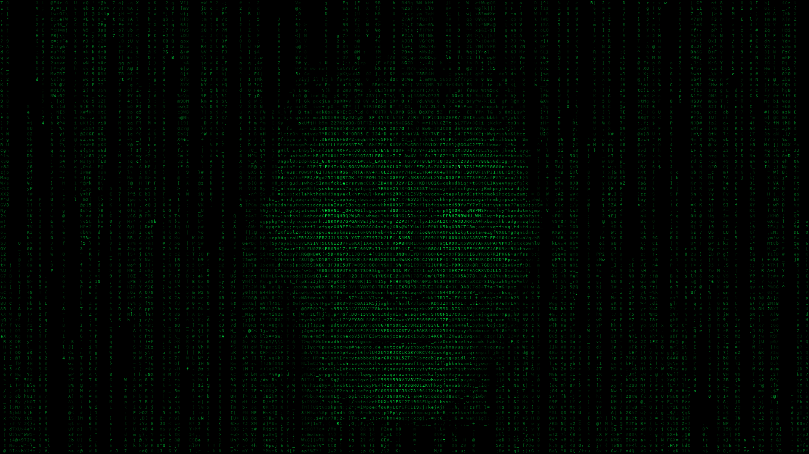

# Jarvis Head (matrix kiosk)



Jarvis Head is an optional display for a monitor attached to the Jarvis host. Matrix rain fills the screen while idle. A face emerges when Jarvis hears the wake word, blinks while listening, and animates its mouth from the speech audio during playback.

The display runs independently of voice capture, the orchestrator, and audio playback. It starts manually and is not included in Docker or the normal service startup. Enabling its event hooks does not start a display.

## Video demo

This framebuffer demonstration shows the face emerging from the rain, reacting while active, speaking with audio-driven mouth movement, and dissolving back into the rain.

https://github.com/user-attachments/assets/101c682d-7ed3-4734-b156-fc238d2d4077

## Requirements

Start with a working [native Jarvis installation](INSTALL_GUIDE.md). The display launcher selects the repository `.venv` when available, then `~/jarvis-venv`. Pillow and NumPy are included in the project's Python dependencies. If the repository environment is missing or incomplete, install its locked dependencies from the repository root:

```bash
uv sync --dev --frozen
```

There are two ways to display the head:

| Renderer | Requirements | Use |
| --- | --- | --- |
| `curses` (default) | An attached terminal with curses support | Terminal-cell display; a direct launch is useful for trying the animation |
| `fb` | A Linux virtual console, a supported framebuffer, and a monospace TrueType font | A finer glyph grid and additional lighting effects on a physical monitor |

The dedicated-monitor wrapper requires a systemd-based Linux host with kernel virtual consoles (`/dev/ttyN`), `sudo` access, and `openvt`, `chvt`, `fgconsole`, and `setpriv` from the `kbd` and `util-linux` packages. It does not create a desktop session or position windows on an X/Wayland monitor.

### Framebuffer requirements

For `--renderer fb`:

- The display user needs read/write access to the framebuffer device, normally `/dev/fb0`.
- A monospace TrueType font must be installed. DejaVu Sans Mono is the first default candidate; `JARVIS_HEAD_FONT` or `--font` can select another `.ttf`.
- The device must use 32 bits per pixel with three distinct 8-bit color channels at offsets 0, 8, and 16, no reversed channel bits, and no display pan. The visible page must begin at byte zero and fit within the reported framebuffer memory. Unsupported layouts are rejected.

On Debian/Ubuntu, common setup commands are:

```bash
sudo apt install fonts-dejavu-core
sudo usermod -aG video "$USER"
cat /sys/class/graphics/fb0/bits_per_pixel
```

Check the device's group and permissions before changing group membership. Log in again after a group change. The kiosk initializes the display user's supplementary groups when it launches.

The framebuffer renderer requires a real Linux virtual console on standard input. For a physical monitor controlled from SSH, use `bin/kiosk.sh`; a direct framebuffer launch from an SSH terminal is refused. Offscreen snapshots need neither a framebuffer device nor console privileges.

## Quick start

Run commands from the repository root. To try the default terminal renderer:

```bash
./bin/jarvis-head --demo-face
```

Press `q`, Escape, or Ctrl+C to exit. This demo forces the face to stay visible and does not receive wake or speech events.

For a normal terminal display that receives events:

```bash
./bin/jarvis-head
```

It starts as rain. [Enable the wake and speech hooks](#hook-points) to make the face react to Jarvis.

## Dedicated monitor (Linux virtual terminal)

The kiosk wrapper runs the display on an unused virtual terminal, separate from the wake process and its tmux session. Stop any directly launched display before starting it.

```bash
./bin/kiosk.sh start
./bin/kiosk.sh status
./bin/kiosk.sh stop
```

`start` may request sudo authentication. It creates a transient `jarvis-head-kiosk.service`, switches the monitor to `tty8` by default, and returns. The display runs as the invoking non-root user and survives loss of the launching SSH connection. The service has a default limit of 50% of one CPU and 256 MiB of memory. Nothing is installed or enabled at boot, and `bin/start`, the dashboard, and the wake process do not start or supervise it.

On the physical keyboard, use `q`, Escape, or Ctrl+C for a normal exit. The wrapper returns the monitor to the virtual terminal that was active at startup. Keep the primary login console available; Ctrl+Alt+F1 provides a local recovery route.

Pass display options after `--`:

```bash
# Framebuffer renderer with the default font size.
./bin/kiosk.sh start -- --renderer fb

# A finer glyph grid.
./bin/kiosk.sh start -- --renderer fb --font-px 8

# A partly revealed face with lower brightness.
./bin/kiosk.sh start -- --renderer fb --face-presence 0.45 --face-brightness 0.4

# Reduce redraw work or change the color.
./bin/kiosk.sh start -- --fps 20 --color red
```

Starting an already active kiosk only switches the monitor back to its VT; it does not change the running options. Stop it before starting with new flags:

```bash
./bin/kiosk.sh stop
./bin/kiosk.sh start -- --renderer fb --font-px 8
```

Choose another unused VT, a return console, or the mode whose display settings should be read:

```bash
JARVIS_HEAD_KIOSK_VT=9 JARVIS_HEAD_RETURN_VT=1 ./bin/kiosk.sh start
JARVIS_MODE=local ./bin/kiosk.sh start
```

The wrapper refuses `tty1`, a target with an active getty, and a return VT equal to the kiosk VT. `--snapshot` must be run directly with `bin/jarvis-head`, since it writes a file and exits.

## Hook points

Set this in the selected `config/cloud.env` or `config/local.env` to enable event publishing:

```bash
JARVIS_HEAD_ENABLED=true
```

Restart any already-running wake or speech service that needs to load the setting. Start the display separately with `bin/jarvis-head` or `bin/kiosk.sh`.

The shared `bin/tts-common.sh` playback helper sends speech events for `say.sh`, `say-local.sh`, `say-status.sh`, and `say-status-local.sh`. Callers using those scripts include wake greetings, voice answers, reminders, alert announcements, follow-ups, and status phrases. A spoken reminder or alert can bring the face out of idle without a preceding wake word.

Both wake scripts send `listen` and `sleep`. While a question process runs, a 30-second keepalive keeps the listening face visible through long recordings, transcription, and tool calls. The current wake path does not send `think`; the optional ambient scan supplies a visual sweep without changing that state.

Browser-only TTS (`POST /api/tts`), Docker proactive speech, and scripts that call `aplay` directly (`bin/question.sh`, `bin/question-local.sh`, and `bin/question-mic.sh`) do not drive the head through these hooks. The display is not an LLM tool.

### Speak emit lives inside the lock

Speech events are emitted after the playback lock is acquired, immediately before each `aplay` attempt. Each attempt has its own `playback_id`; the matching `speak_end` reports success or failure. This keeps the mouth aligned with playback even when another utterance is waiting for the speaker. The display follows the supplied playback start time rather than packet arrival time.

The display analyzes the WAV into a small in-memory mouth timeline when it receives `speak`, so speech scripts can delete temporary WAVs after playback. If the end event is lost, the overlay ends after the WAV duration plus one second of slack.

## Renderers and appearance

The `kiosk` rain preset fills the screen with a dense field. The `reference` preset retains the guttered streams of [Matrix Crypto](https://github.com/bigsk1/matrix-crypto), from which the rain engine is adapted.

Both renderers use the same scene, masks, state machine, mouth timeline, and event socket. Eyes and mouth emerge before the rest of the face; blinking, drift, and gradual glyph changes keep it moving while listening. The rain continues around and through the face.

### Terminal renderer

The default `curses` renderer uses terminal cells. Color detail depends on the terminal: the Linux console supports a 14-shade custom ramp, a 256-color terminal uses a snapped color ramp, and simpler terminals use fewer shades. The console palette is restored on exit.

Terminal cells are taller than they are wide. `--cell-aspect` sets their width/height ratio when fitting the face; lower values make the head wider. The default is `0.4`, configurable with `JARVIS_HEAD_CELL_ASPECT`. Resizing the terminal refits the mask and rain.

### Framebuffer renderer

`--renderer fb` draws the same glyph scene as pixels, using a TrueType glyph atlas and a 256-level brightness ramp. Smaller font sizes provide more cells and finer facial detail. The font's measured cell ratio controls face width; `JARVIS_HEAD_CELL_ASPECT` is ignored for this renderer unless `--cell-aspect` is explicitly passed.

Framebuffer effects include gradual face reveal, breathing, a glow where rain crosses the face, short phosphor trails, scanlines, and a lower-face pulse from speech energy. These effects do not require a GPU or browser.

| Control | Range/default | Effect |
| --- | --- | --- |
| `--face-brightness` | `0.2`–`1.5`; default `1.0` | Scales face brightness above the ramp floor; framebuffer only |
| `--face-presence` | `0.3`–`1.0`; default `1.0` | Caps how much of the face resolves; both renderers |
| `--font-px` | `6`–`24`; default `10` | Glyph size in pixels; framebuffer only |
| `--scan-levels` | `-255`–`255`; default `72` | Positive brightens the scan band, negative darkens it, and zero hides it |

Presence around `0.45` keeps the features visible while leaving much of the skull in the rain. Brightness and presence can be adjusted independently. The glyph shapes still depend on the mask, so lowering brightness changes their intensity rather than replacing dense highlight glyphs.

A `think` event produces a continuous scan. With `JARVIS_HEAD_AMBIENT_SCAN=true`, occasional visual sweeps also run while the face is listening or speaking. The default first sweep is after three seconds, followed by random pauses of 10–14 seconds. A primary sweep has a 15% chance of a second pass with a brief one-cell nudge. The effect resets when the face disappears; a real `think` event takes precedence. Ambient scan is off by default.

### General display options

```bash
./bin/jarvis-head --preset reference
./bin/jarvis-head --fps 20 --color cyan
./bin/jarvis-head --seed 42
./bin/jarvis-head --help
```

The frame-rate cap is 30 FPS by default, with a permitted range of 1–120. Lowering it can reduce CPU use; choose a value that looks smooth on the target monitor. Fixed seeds make demos and snapshots repeatable.

Color choices are `green`, `cyan`, `blue`, `red`, `yellow`, `magenta`, and `white`.

## Config keys

The same commented settings are available in [cloud.env.example](../config/cloud.env.example) and [local.env.example](../config/local.env.example):

```bash
# Enable the optional wake/speech event publisher; does not start a display.
# JARVIS_HEAD_ENABLED=false
# JARVIS_HEAD_SOCKET=   # optional absolute path; blank uses the private default
# JARVIS_HEAD_CELL_ASPECT=0.4
# JARVIS_HEAD_IDLE_TIMEOUT=120
# JARVIS_HEAD_KIOSK_VT=8
# JARVIS_HEAD_RETURN_VT=   # default: active VT at kiosk startup
# JARVIS_HEAD_KIOSK_USER=  # default: invoking non-root user
# JARVIS_HEAD_KIOSK_CPU_QUOTA=50%
# JARVIS_HEAD_KIOSK_MEMORY_MAX=256M
# JARVIS_HEAD_RENDERER=curses
# JARVIS_HEAD_FRAMEBUFFER=/dev/fb0
# JARVIS_HEAD_FONT=  # default: first installed monospace font candidate
# JARVIS_HEAD_FONT_PX=10
# JARVIS_HEAD_FACE_BRIGHTNESS=1.0
# JARVIS_HEAD_FACE_PRESENCE=1.0
# JARVIS_HEAD_SCAN_LEVELS=72
# JARVIS_HEAD_AMBIENT_SCAN=false
# JARVIS_HEAD_AMBIENT_SCAN_FIRST_SECONDS=3.0
# JARVIS_HEAD_AMBIENT_SCAN_MIN_SECONDS=10.0
# JARVIS_HEAD_AMBIENT_SCAN_MAX_SECONDS=14.0
# JARVIS_HEAD_AMBIENT_SCAN_DOUBLE_CHANCE=0.15
```

Display settings are loaded at startup from the selected mode file. Explicit environment values override that file, and display flags override the corresponding settings. The kiosk forwards the supported head settings into its clean display session. Stop and start the display after changing settings.

Ambient timing values must be finite and no greater than 600 seconds. The first delay can be zero; kiosk minimum/maximum pauses must be at least 0.1 seconds, and the maximum must be no less than the minimum. The double-sweep probability is between zero and one. The kiosk checks renderer, framebuffer path, brightness, presence, scan offset, and ambient settings before creating the unit; invalid settings produce an error in the launching terminal. A unit can still fail later because of device permissions, font availability, or other runtime errors; check its journal.

`JARVIS_HEAD_IDLE_TIMEOUT` returns a listening/thinking face to rain after inactivity. The default is 120 seconds; wake's keepalive renews activity during an active question. Cloud and local choose the existing Jarvis configuration and speech path, not a different head mode.

## Manual command reference

### Visual-only face and WAV demos

```bash
./bin/jarvis-head --demo-face --cell-aspect 0.4
./bin/jarvis-head --demo-wav /absolute/path/to/speech.wav
./bin/jarvis-head --renderer fb --demo-think
./bin/jarvis-head --renderer fb --demo-face --face-presence 0.45 --face-brightness 0.4
```

Framebuffer demos need a Linux virtual console; to launch one from SSH, pass the same flags after `./bin/kiosk.sh start --`.

`--demo-wav` loops its visual timeline without playing audio. It accepts uncompressed PCM WAVs with 8/16/24/32-bit samples, 8–96 kHz sample rates, and up to eight channels, bounded to 64 MiB and 300 seconds. The mouth uses 50 ms energy and spectral windows to choose rest, closed, open, and round apertures. This approximates mouth motion from sound; it does not recognize phonemes or read microphone volume.

Demo modes force a visual state and do not bind the event socket. Use a normal display without `--demo-*` flags for live wake and speech events.

### Offscreen snapshots

```bash
./bin/jarvis-head --snapshot /tmp/head.png --seed 42
./bin/jarvis-head --snapshot /tmp/head.png --snapshot-at 0.5 --seed 42
./bin/jarvis-head --snapshot /tmp/head.png --font-px 8 --seed 42
./bin/jarvis-head --snapshot /tmp/head.png --demo-think --snapshot-at 6.3 --seed 42
./bin/jarvis-head --snapshot /tmp/head.png --demo-wav /absolute/path/to/speech.wav --snapshot-at 1.6
```

`--snapshot` selects the framebuffer compositor, implies demo mode, and writes one 1920×1080 PNG without opening a device or event socket. It can run from SSH without root. The default simulated time is four seconds; `--snapshot-at` accepts 0–600 seconds. With a fixed seed and the same inputs, output is repeatable. A snapshot checks the composed image; device access and console restoration still need a physical-monitor check.

### Send state events manually

Leave the normal display running, then use another terminal as the same user:

```bash
export JARVIS_HEAD_ENABLED=true

./bin/jarvis-head emit listen
./bin/jarvis-head emit think
./bin/jarvis-head emit sleep
./bin/jarvis-head emit --help
```

To test mouth motion without playing audio:

```bash
WAV=/absolute/path/to/speech.wav
ID="manual-$(date +%s%N)"

./bin/jarvis-head emit speak \
  --wav "$WAV" \
  --playback-id "$ID" \
  --t0 "$(date +%s.%N)"

# Optional: finish before the WAV-duration fallback.
./bin/jarvis-head emit speak_end --playback-id "$ID" --ok true
```

### Check real speech and wake integration

These commands generate and play real TTS while the normal display is running. They use the configured provider and may incur a provider charge when the phrase is not cached:

```bash
JARVIS_HEAD_ENABLED=true ./bin/say-status.sh "Jarvis Head cloud test" true
JARVIS_HEAD_ENABLED=true ./bin/say-status-local.sh "Jarvis Head local test" true
```

For a wake check, stop any existing wake listener first to avoid competing for the microphone. Run one of these, according to the configured mode:

```bash
JARVIS_HEAD_ENABLED=true ./bin/wake-jarvis.py
JARVIS_HEAD_ENABLED=true ./bin/wake-jarvis-local.py
```

### Runtime overrides

```bash
# Keep listen/think visible for five minutes without further events.
JARVIS_HEAD_IDLE_TIMEOUT=300 ./bin/jarvis-head

# Enable bounded publisher diagnostics.
JARVIS_HEAD_ENABLED=true JARVIS_HEAD_DEBUG=true ./bin/jarvis-head emit listen

# Select a private socket shared by all participating processes.
install -d -m 700 /tmp/jarvis-head-manual
export JARVIS_HEAD_SOCKET=/tmp/jarvis-head-manual/head.sock
```

For a socket override, export the same absolute `JARVIS_HEAD_SOCKET` before starting the display and every emit, TTS, or wake process.

## State: base + speech overlay

The base state is `SLEEP`, `LISTEN`, or `THINK`. Speech is a separate overlay, so an alert can animate the face without putting it into listening mode.

| Event or condition | Display behavior |
| --- | --- |
| Idle (`SLEEP`) | Rain only |
| `listen` / `think` | Face appears and stays visible until sleep or inactivity timeout |
| `speak` while idle | Face appears for speech, then returns to rain |
| `speak` while listening/thinking | Mouth follows speech, then the listening/thinking face remains |
| `sleep` during speech | Speech overlay finishes, then the face returns to rain |
| Retry with a new playback ID | New overlay replaces the old one; a late end event for the old ID is ignored |
| Stale or invalid speech event | Event is ignored |

## Event protocol

Events are JSON datagrams on a local Unix socket. The default is `/tmp/jarvis-head-<uid>/head.sock`, with a private `0700` directory and `0600` socket. Each user has a separate endpoint. A custom socket path must be absolute and have a safe writable parent directory.

| Type | Fields in addition to `type` | Meaning |
| --- | --- | --- |
| `listen` | None | Show the listening face |
| `think` | None | Show the thinking face |
| `speak` | `playback_id`, `wav`, `t0` | Start a WAV-backed overlay; `t0` is Unix epoch seconds with a fractional part |
| `speak_end` | `playback_id`, `ok` | End the matching playback attempt |
| `sleep` | None | Return the base state to idle |

The maximum datagram size is 4 KiB. Unknown types, extra fields, malformed data, and unusable WAVs are ignored. WAVs must be readable regular PCM files within the limits listed above. `playback_id` identifies one playback attempt, not a reusable audio file.

The display holds a singleton lock for the socket's lifetime. Another display cannot take over an active socket. An owned stale socket can be recovered after the lock is free; ordinary files, symlinks, devices, and other users' sockets are not removed. Normal exits release the lock and unlink the socket.

## Failure boundary: the head cannot take Jarvis down

Wake and speech send one-way, nonblocking events. There is no acknowledgement dependency on the display. A missing, stopped, or failed display leaves speech generation and playback running; send failures are silent unless `JARVIS_HEAD_DEBUG=true`. With publishing disabled, the shell playback helper skips the emitter process entirely.

The display has a frame-rate cap and bounded event and WAV inputs. Its terminal cleanup is separate from Jarvis's voice processes. The kiosk's transient service adds CPU and memory limits; the display still shares the host's physical resources.

On framebuffer exit, the display restores terminal attributes, blanks the framebuffer, restores the prior console mode, and closes the device. The kiosk retries switching back to the return VT for up to four seconds. Failed console-mode or VT restoration produces warnings in the journal. SIGKILL cannot run this cleanup and can leave the kiosk VT in graphics mode; use the recovery steps below.

## Troubleshooting

- **No face during wake or speech:** start a normal display without demo flags, enable `JARVIS_HEAD_ENABLED` in the sender's configuration, and confirm the display and sender use the same user and absolute socket path. A successful `emit` command is not a delivery acknowledgement; use `JARVIS_HEAD_DEBUG=true` for send errors.
- **Kiosk starts and immediately exits:** check `./bin/kiosk.sh status` and `sudo journalctl -u jarvis-head-kiosk.service -e`. Common causes include a missing framebuffer device, insufficient access, or no usable TrueType font. A group change requires a new login.
- **Black screen or stranded kiosk VT:** press Ctrl+Alt+F1 locally, run `./bin/kiosk.sh stop` from that console or SSH, then inspect the journal for `chvt` or `KD_TEXT` warnings. A clean framebuffer start/stop on the same VT can restore its text mode after SIGKILL.
- **New options do not take effect:** an active kiosk keeps its original arguments. Stop it, then start again with the new flags or settings.
- **Face is too bright or too fully visible:** for `fb`, try `--face-presence 0.45 --face-brightness 0.4` and adjust for the monitor. Presence works on both renderers; the brightness gain is framebuffer-only.
- **Face is stretched:** set `--cell-aspect` for the actual terminal font. The framebuffer renderer normally measures its own font ratio; only an explicit flag overrides that measurement.
- **High display CPU use:** lower `--fps`, compare `curses` and `fb` on the target host, and check the kiosk's configured CPU limit. Visual density, font size, resolution, and terminal redraw costs affect the result.

## Layout

The display lives in the `jarvis-head/` application directory. `bin/jarvis-head` adds it to the import path. The lightweight publisher lives in `lib/`, so wake and TTS do not import curses or the renderer.

```text
bin/jarvis-head              # display, demos, snapshots, emit
bin/kiosk.sh                 # manual Linux-VT start / stop / status
lib/head_events.py           # nonblocking Unix datagram publisher
jarvis-head/
  app.py                     # shared scene, curses renderer, renderer dispatch
  fb_render.py               # framebuffer compositor and snapshots
  fbdev.py                   # framebuffer access and console mode restoration
  glyphs.py                  # TrueType glyph atlas and font discovery
  head_protocol.py           # bounded event validation
  head_socket.py             # singleton lock and socket lifecycle
  head_state.py              # base state and speech overlay
  rain.py                    # Matrix Crypto-derived rain model
  palette.py                 # tonal ramps
  mask.py                    # authored face masks and cell-aspect fitting
  visemes.py                 # bounded WAV analysis and mouth timeline
  assets/                    # face, blink, and four mouth-aperture PNGs
```

## Tests

From the repository root:

```bash
.venv/bin/python -m pytest tests/test_jarvis_head_*.py tests/test_tts_playback_scripts.py -q
```

These tests cover rain and face rendering, masks and palettes, bounded WAV analysis, event validation, socket ownership, state transitions, wake and playback hooks, and kiosk lifecycle commands. Framebuffer tests use fake devices and offscreen composition; playback tests use a fake `aplay` rather than playing audio. A real monitor is needed to check its appearance, VT switching, and restoration on the target host. See [Testing](TESTING.md) for the full regression command and test-isolation rules.
