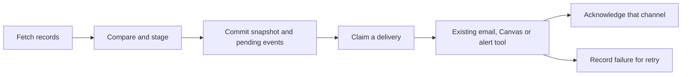

# Shared watch state

`watch_state` compares records by stable ID and retains field changes, history,
and delivery receipts. Workflows, the chat tool, and authenticated API callers
use the same Python core in `lib/watch_state`. No new database server, model,
package, or background worker is required.

Use it for changing prices, inventories, release catalogs, or other structured
lists. The caller still fetches the source and decides where to send a change.
The state layer does not browse, send email, create alerts, or install schedules.

## State and delivery

1. Register a watch definition with a stable key and record ID field.
2. Fetch and validate the source records.
3. Compare them to the current baseline. The returned run ID identifies a staged
   preview; comparison does not advance the baseline.
4. Commit that run. One transaction accepts the snapshot and stores change
   events and requested delivery intents.
5. Claim each pending channel/destination, deliver through an existing tool,
   then acknowledge that particular delivery with its claim token.



A successful commit confirms storage, not notification delivery. Later checks
can advance the baseline while an earlier email remains pending. A successful
Canvas acknowledgment does not acknowledge email. Failed delivery attempts are
bounded and eventually parked for inspection; there is no new automatic sender.

Claims prevent two active consumers from handling the same pending delivery at
once. They cannot guarantee exactly-once delivery to an external service: a
crash after sending and before acknowledgment can still require reconciliation.
Use a transport's deduplication key when it supports one.

The first accepted snapshot is quiet by default. A missing record is removed
only after the configured number of distinct committed complete snapshots;
the default is two. Partial snapshots never establish removals. Returning after
a confirmed removal produces a separate reappeared event. A retried commit
does not count as another missing run.

Only declare a snapshot complete after collecting the entire relevant source
list. A search page, top-ten recommendations, truncated result, or failed fetch
is not a complete inventory. Oversized inputs are rejected rather than silently
truncated into an apparently complete list. Large text should remain in Stash,
with a reference and a few comparison fields in the watch record.

## Modes and ownership

The tool automatically uses the running request's cloud or local mode. Shared
workflow definitions and tool profiles need no extra mode settings. Baselines,
pending deliveries, and history are separate by mode in `data/watch_state.db`.
SQLite WAL and short transactions allow concurrent readers while revision
checks reject conflicting commits. No database lock is held during delivery.

Each watch has one writer. A workflow's writer identity comes from its actual
execution context, not a model-filled argument. Other workflows may inspect it
but cannot replace its baseline or acknowledge its events. Interactive watches
belong to the interactive caller. Authenticated API administration can register
a definition for a named workflow owner.

Ownership controls writes, not confidentiality: other workflows in the same mode
may inspect records and history. A personal recipe that overrides a built-in
workflow with the same ID has that workflow's writer identity and ledger access.
Use a distinct workflow ID for an independent personal recipe.

The two existing movie/TV sent-history ledgers are deliberately shared across
modes and genres. They import their reviewed legacy Stash metadata and retain
permanent handled-ID receipts. Only a successfully emailed selected pick is
recorded; Canvas-only runs and other discovered candidates are not marked sent.
The workflow no longer writes new Stash bookkeeping entries. Existing Stash
files are preserved, including installations using a custom `STASH_DIR`.
The current TMDB discovery tools accept at most 500 excluded IDs. If a radar
ledger exceeds that consumer limit, the workflow stops before discovery/email
and preserves the entire ledger; it never drops older IDs to make the call fit.
This blocked check is recorded as a watch-health error for self-check. A later
successful ledger check clears the error without removing sent IDs.

Only those two built-in radar keys use the shared scope. Other workflow keys,
including personal ones, use the current mode; keeping a recipe under
`data/workflows/personal/` does not enable cross-mode sharing. Existing personal
tools and their own state files are not migrated automatically. Private workflow
IDs belong in their ignored recipes, not in the built-in radar-key set.

## Operations

For example, register a price watch with this tool input:

```json
{
  "action": "register",
  "key": "house_prices",
  "definition": {
    "id_field": "listing_id",
    "compare_fields": ["price", "status"],
    "ignore_fields": ["fetched_at"],
    "normalizers": {"price": {"type": "money", "currency": "USD"}},
    "complete": false,
    "missing_grace": 2,
    "quiet_first": true,
    "stale_after_seconds": 0,
    "channels": []
  }
}
```

Then compare a successful fetch:

```json
{
  "action": "compare",
  "key": "house_prices",
  "records": [{"listing_id": "000123", "price": "$649,000", "status": "active"}],
  "request_id": "source-run-2026-11-13-01"
}
```

Commit using the exact returned `run_id`. A later accepted observation with
`price: 625000` yields a price change rather than a formatting-only difference.
`channels: []` records history only. To queue deliveries, register exact targets
such as `{"channel":"email","destination":"reader@example.test"}`; an existing
workflow or caller must still deliver them and acknowledge its real receipt.
Use a new `request_id` for each source run and reuse it only for a retry of that
same observation. Changing comparison rules requires a deliberate baseline
reset and an increased definition `schema_version`.

The tool supports registration, comparison, commit, delivery claim and
acknowledgment, pending inspection, record history, watch listing/inspection,
mute, reset, deletion, and health. A comparison dry run produces a preview
without staging or changing watch state. Explicit normalizers make equivalent
representations comparable; record IDs remain exact, including leading zeros.

`compare_fields` and `ignore_fields` select what triggers a change. They do not
select what is stored: each commit saves the complete normalized record, even
when only an ignored field changed and no event was created. Historical event
records also retain the fields supplied at that time. Remove sensitive fields
before passing records to the core, tool, or API if they must not be retained.

History retention is separate from pending delivery and handled-ID identity.
Cleaning old observation content must not make previously emailed movies new
again. Resetting a baseline retains delivery receipts. Destructive deletion is
an explicit management operation.
Delete removes observation snapshots, event history, delivery intents, and run
payloads; registering the same key starts a fresh observation history. Minimal
committed-run receipts and request-ID fences remain to make late retries safe;
use fresh request IDs for new observations. Permanent handled-ID receipts remain
unless an authenticated administrator
explicitly requests `delete_handled: true`. Reset, unlike delete, retains prior
events and committed pending deliveries.

`record_delivery` and `handled` provide a permanent per-record sent-ID ledger,
as used by the radars. They are not the acknowledgment path for repeated price
changes to the same record. Use each change event's claim/ack flow for that.
`record_error` reports a failed source check without accepting an empty snapshot.
Successful commits and recorded deliveries perform bounded retention cleanup
automatically. `cleanup` can also perform explicit maintenance; permanent
handled IDs survive. Discard an unused staged run without resetting its baseline.
Muting pauses delivery claims while observations and pending events are retained.
Unmuting makes that work available again. Parked deliveries require an explicit
authenticated administrator retry; the model-facing tool cannot restart their
retry allowance.

`/jarvis_self_check` reports stale watches, watch errors, parked deliveries, and
pending counts. Pending work alone is not a health alert. Disable staleness for
on-demand watches rather than treating them as failed schedules.
New definitions default `stale_after_seconds` to zero. Set a positive threshold
when the caller has an expected schedule; an ID-only definition does not imply
a daily check. Existing stored definitions retain their configured threshold.
Its Canvas health report includes watch keys, owner IDs, and definitions, so a
personal watch registered in the active mode is visible there too. Gitignored
recipes and storage do not make watch metadata private from the local app.

Web tool results use a compact closed card. Saved follow-up context keeps exact
watch, run, event, and claim handles with bounded previews and explicit
truncation indicators. Use inspect, pending, or history to retrieve more data.

## HTTP access

The existing FastAPI service exposes `/api/watch`. Every route requires
`Authorization: Bearer <JARVIS_API_KEY>`, including loopback and installations
where general API authentication is disabled. An unset key disables this API
surface. Web UI login tokens are not API keys.

The optional `mode=cloud|local` query selects the mode; omission uses the API's
active mode. The selected mode's configured API key is required. Requests cannot
choose a database path, project root, or arbitrary shared namespace.

The API offers list/health, per-key inspection/registration/deletion, staged
comparison/commit, per-channel delivery handling, history, and management.
The generated API documentation describes the exact request fields.

| Request | Purpose |
| --- | --- |
| `GET /api/watch` | List watches for the active mode, including shared radar ledgers. |
| `GET /api/watch/health` | Read aggregate watch health. |
| `GET /api/watch/{key}` | Inspect a watch. |
| `PUT /api/watch/{key}` | Register a definition; authenticated administration may specify its owner. |
| `POST /api/watch/{key}/{action}` | Compare, commit, claim, ack, pending, history, handled, inspect, or manage. |
| `DELETE /api/watch/{key}` | Delete a watch while retaining handled-ID identity by default. |

For namespaced keys, the complete key may contain `/`. A key named `health`
can be inspected using `POST /api/watch/health/inspect` with an empty object.
Read actions such as history/pending use POST to keep their names from
shadowing a valid watch key ending in `/history` or `/pending`.

## Scope

Version one provides deterministic field comparison, explicit normalization,
missing-record grace, staged revision checks, durable per-channel receipts,
history, health, and the radar migration. Percentage thresholds, configurable
alert-routing rules, a universal delivery worker, and a dedicated watch
dashboard are not implemented. Existing specialized RSS and release watchers
keep their source-specific publication checks.
