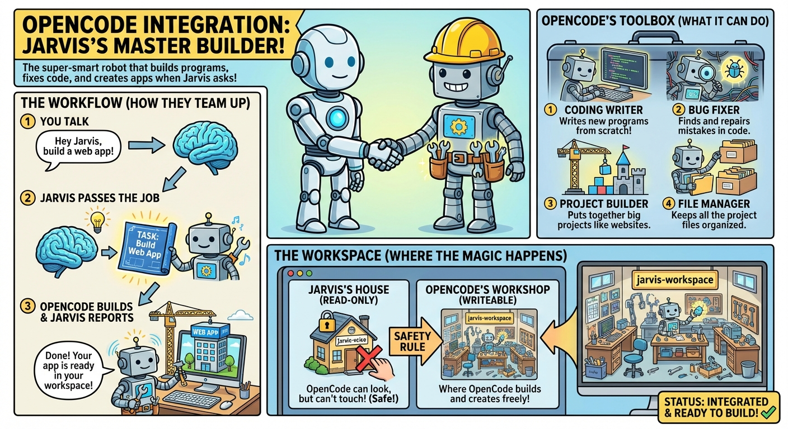

# OpenCode V2 Integration



OpenCode is an optional coding agent that Jarvis calls to build, debug, and
review projects. Jarvis uses the **OpenCode 2.x HTTP API** and supervises each
request until it completes, fails, is cancelled, or reaches its deadline.
OpenCode 1.x servers and V1 plugin implementations are not compatible with this
bridge. The migration targets the released 2.1.0 API contract; rerun integration
checks when upgrading, especially where experimental routes are involved.

OpenCode runs as a separate service. It is not required for normal Jarvis chat,
voice, Web, API, or memory features, and the core Jarvis installer does not
install it.

## How the pieces fit

```text
Voice / CLI / Web / API
    -> Jarvis opencode tool
    -> authenticated OpenCode V2 server on port 4096
    -> configured model provider and OpenCode tools
    -> project files in ~/jarvis-workspace
    -> progress and final answer back to Jarvis
```

The native Linux setup keeps one dedicated `opencode-jarvis.service` under
systemd. OpenCode's normal terminal client can also manage its own shared
background service; that is a different process and may use a different port.
Connect the terminal to Jarvis's server explicitly when you want the same
sessions:

```bash
opencode ~/jarvis-workspace --server http://localhost:4096
```

Use the configured workspace path instead when `JARVIS_WORKSPACE_ROOT` differs.

A local OpenCode process can use a cloud model. With direct provider
credentials, requests go from the host to the selected provider. OpenCode
Console/Go and saving provider keys in OpenCode's hosted Console are optional;
Jarvis's native service setup does not require them. See the upstream
[provider guide](https://opencode.ai/v2/docs/providers/).

## New native Linux installation

Run these commands from the Jarvis checkout as the account that will own the
service and workspace. The systemd integration is Linux-specific; it does not
establish native Windows or macOS service support.

### 1. Install OpenCode V2

For the curl installation used by the service template:

```bash
curl -fsSL https://opencode.ai/v2/install | bash
~/.opencode/bin/opencode --version
```

Check that the version starts with `2.`. The service template uses
`~/.opencode/bin/opencode`; a package-manager binary elsewhere requires
adjusting the service executable. Do not install V1 and V2 over the same
package-managed installation. See upstream
[installation](https://opencode.ai/v2/docs/) and
[V1 migration](https://opencode.ai/v2/docs/migrate-v1/) instructions.

### 2. Configure the selected Jarvis mode

In `config/cloud.env` or `config/local.env`, enable the tool and select a model
that your provider account can use:

```bash
OPENCODE_ENABLED=true
OPENCODE_BASE_URL=http://localhost:4096
OPENCODE_PROVIDER=xai
OPENCODE_MODEL=grok-4.7
OPENCODE_TASK_TIMEOUT_SECONDS=900
OPENCODE_SERVER_USERNAME=opencode
OPENCODE_SERVER_PASSWORD=replace-with-a-long-random-password
XAI_API_KEY=replace-with-your-provider-key
```

Other direct-provider examples are `openai` with `gpt-6.1-sol` and `anthropic`
with `claude-sonnet-5-5`, using `OPENAI_API_KEY` or `ANTHROPIC_API_KEY`.
Ollama uses the `ollama` provider, an installed tool-capable model, and the
endpoint declared in the OpenCode config. Model availability and billing
belong to the selected provider.

`OPENCODE_PROVIDER` and `OPENCODE_MODEL` select Jarvis coding tasks independently
of Jarvis's chat model and OpenCode's interactive default. Explicit settings
win in either Jarvis mode. Without them, local mode resolves its Ollama model;
cloud mode uses the Anthropic catalog fallback. Local Jarvis mode therefore
does not guarantee that OpenCode runs offline.

Keep server credentials consistent in every Jarvis mode that calls this
server. One OpenCode service has one service environment, even when both
Jarvis modes use it.

### 3. Prepare configuration, workspace, and service

```bash
./bin/install-opencode-service.sh
```

The installer checks that the binary is V2, preflights existing configuration,
seeds required workspace directories and a new config when absent, prepares the
private environment, installs the plugin, renders the service, and verifies the
running V2 version and plugin. Existing provider/model choices are retained;
the migration rules below explain the settings that may change.
Do not rerun the legacy `setup_opencode_workspace.sh` to upgrade a workspace.

The env source defaults to `OPENCODE_ENV_FILE`, otherwise
`config/${JARVIS_MODE:-cloud}.env`. An explicit path argument takes precedence.
For a local-only installation:

```bash
./bin/install-opencode-service.sh config/local.env
# Equivalent env override:
# OPENCODE_ENV_FILE=config/local.env ./bin/install-opencode-service.sh
```

To prepare or migrate config without installing or restarting the service,
run `./bin/setup-opencode-config.sh [ENV_FILE]`. The installer handles the
environment, directories, and plugin separately. The scripts parse supported
settings without sourcing or executing the env file.
Set `JARVIS_WORKSPACE_ROOT` in that source env before installation when using a
custom workspace. Keep the same path in every Jarvis mode calling the service.

The tracked template is `config/opencode.config.json.template`. Fresh configs
use native V2 fields such as `providers`, `permissions`, and `agents.title.model`.
The title helper uses the selected coding model on a fresh setup, so a
cloud-only install does not require an additional local chat model.
Customize the OpenCode provider endpoint and model selections for the host.
Other existing config content is preserved; V2 translates supported V1 fields
at load time, so review legacy settings and startup warnings after migration.

The installer seeds global coding instructions from the tracked
[`config/opencode.instructions.md.template`](../../config/opencode.instructions.md.template)
only when `~/.config/opencode/AGENTS.md` is absent. Existing instructions are
preserved for the operator to review. Local ignored `AGENTS.md` development
guides are not installation inputs.

| Location | Purpose |
| --- | --- |
| `~/.config/opencode/opencode.json` | OpenCode server configuration and interactive default model |
| `~/.config/opencode/jarvis-env.env` | Private provider credentials and server authentication for systemd |
| `~/.config/opencode/plugins/00-workspace-protection.js` | Installed V2 workspace protection plugin |
| `~/.config/opencode/AGENTS.md` | Coding instructions seeded only when absent; existing instructions are preserved |
| `~/jarvis-workspace/projects/` | Persistent coding projects |
| `~/jarvis-workspace/temp/` | Scratch files, command output, and temporary builds |
| `~/jarvis-workspace/deployments/` | Prepared deployment artifacts |
| `systemd/opencode-jarvis.service` | Tracked service template rendered for the installing account |

The service binds `0.0.0.0:4096` by default, so require server authentication
before making it reachable beyond the host. Jarvis sends HTTP Basic auth using
`OPENCODE_SERVER_USERNAME` and `OPENCODE_SERVER_PASSWORD`. Protect remote access
with the deployment's firewall and HTTPS arrangement. The server's service
credentials are separate from model-provider credentials.

V2's Basic-auth username is fixed to `opencode`; remove or update a custom V1
username in each calling Jarvis mode. The installer requires a configured
password and rejects a different username before writing the service env.

### 4. Verify without a model request

```bash
sudo systemctl status opencode-jarvis.service
./tests/integration/test-opencode-integration.sh
./tests/integration/test-opencode-integration.sh --health cloud
```

Use `--health local` for a local-only configuration. The health command checks
the configured V2 server and authentication; it does not create a session or
call a model. The default wrapper runs deterministic tests through repo `.venv`
when available. Health/live operations use
`${JARVIS_VENV:-$HOME/jarvis-venv}`.

An explicit provider check creates one real plan-mode session and can incur
charges:

```bash
./tests/integration/test-opencode-integration.sh --live cloud
```

Its prompt requests a short answer without file changes. This confirms a
provider response, not the ability to build and test a complete project.

## Upgrading an existing V1 integration

Back up the current OpenCode config, provider environment, plugins, and session
data before a major upgrade. `opencode debug paths` identifies OpenCode's data
locations. Keep the backup private because it can contain credentials and
conversation content.

1. Stop `opencode-jarvis.service` before replacing the binary.
2. Upgrade to V2 (`opencode upgrade --major` for a supported curl install, or
   follow the upstream V2 installation instructions).
3. Update Jarvis to the matching V2 client and plugin implementation together.
4. Run `./bin/setup-opencode-config.sh`, review the resulting configuration and
   any migration notices,
   then run `./bin/update-opencode-service.sh` with the appropriate
   `OPENCODE_ENV_FILE` if it is not `config/cloud.env`.
5. Run deterministic tests, authenticated health checks, and an explicit live
   request before relying on autonomous coding.

V2 supports many legacy config fields, but that compatibility does not run V1
plugins or preserve the V1 HTTP API. The tracked setup uses V2 plugin discovery
under `plugins/`. It backs up the matching legacy workspace plugin as
`.js.v1-backup` and removes that old active copy from `plugin/`. Review any
additional explicit plugin entries and migrate other V1 plugins separately.

The setup helper recognizes the configuration written by the old Jarvis
generator using its provider definitions, disabled-provider list,
permission map, and absence of custom agent/native policy. The `$schema`
metadata may be absent; when present, it must use the expected OpenCode schema
URL. Existing model selections are optional and preserved. For a recognized
profile, setup converts the old uniform `edit`/`bash` permission map into the
unattended V2 policy and changes `autoupdate: true` to `update: "notify"`.
An explicitly disabled updater remains disabled.
The resulting policy allows edits, shell commands, and external-directory
access, with filesystem writes constrained by the plugin and systemd service.
The helper retains provider/model selections and writes an exact original
backup with the `.v1-backup` suffix before changing the config; a differing
older backup is retained and the new backup gets a timestamp suffix. Matching old
workspace-plugin file entries are removed so V2 can discover the replacement.

Custom broad permission restrictions and unrecognized automatic-update
settings require manual review. The helper stops with an actionable error
instead of replacing that policy; narrower custom rules such as denying
`git push` remain in place. Review the policy for this unattended service while
preserving intentional restrictions. A rule that asks for interaction will
still block a Jarvis coding request when it matches.

The helper preflights both `opencode.json` and `opencode.jsonc` before preparing
runtime files. Its migrator requires strict JSON, including when the filename
ends in `.jsonc`; comments or JSONC-only syntax require manual conversion.
OpenCode V2 itself supports JSONC. This restriction belongs to Jarvis's setup
migrator, not the OpenCode server.

The V2 terminal client stores its UI settings in `~/.config/opencode/cli.json`.
It migrates supported global V1 terminal preferences automatically; the
headless Jarvis service does not read those client settings. Once native V2
configuration has been written, restoring a V1 binary also requires restoring
its matching configuration and plugin backup.

After changing provider keys, server authentication, service settings, or the
tracked plugin, refresh the service:

```bash
./bin/update-opencode-service.sh
# For a local-only env source:
# OPENCODE_ENV_FILE=config/local.env ./bin/update-opencode-service.sh
```

## Workspace controls

The workspace plugin runs **inside OpenCode**. It applies to sessions on that
server whether they originate in Jarvis, a terminal, the web interface, or an
API client. It does not constrain Jarvis's other tools.

The plugin checks supported file-edit operations against the configured
workspace, resolves filesystem paths, and protects the Jarvis checkout.
Read access is broader so the agent can inspect source and installed tools.
Prompt instructions are guidance, not filesystem enforcement.

The Linux service adds filesystem write restrictions for shell commands, Code
Mode, and child agents, which can otherwise perform writes without invoking an
edit hook. The workspace, private temporary storage, and these OpenCode runtime
directories remain writable:

- `~/.local/share/opencode`
- `~/.local/state/opencode`

The runtime directories hold shared session/credential databases and state.
Shell commands, Code Mode, and child processes run with the same
filesystem access as the server: they can read, alter, or delete that shared
OpenCode state. Sessions and projects on this server share that exposure.
Network access, provider credentials, and permitted source reads also remain
available. Use the service for trusted coding work; stronger isolation requires
separate accounts/services or a dedicated sandbox for untrusted code.
See [permissions](OPENCODE_PERMISSIONS.md) and the
[plugin implementation guide](plugin/README.md) for the exact controls.

The supervised service cannot write its global `~/.config/opencode` directory.
Edit provider/config/plugin/instruction files from the host editor or setup
scripts, then restart the service; Web/API actions that rewrite these files can
fail under the service. Session, credential, and saved-permission database
storage remains writable by the server and its child processes. A separate
auto-started OpenCode shared service does not inherit Jarvis's systemd
restrictions.

## Package caches and toolchains

The service redirects package caches and user-installed build tools into the
workspace so ordinary installs can run without making the host home directory
writable. These paths use the actual `JARVIS_WORKSPACE_ROOT`:

| Setting | Workspace location |
| --- | --- |
| `XDG_CACHE_HOME` | `.cache/`, including OpenCode's `.cache/opencode/` |
| `PIP_CACHE_DIR` | `.cache/pip/` |
| `npm_config_cache` | `.cache/npm/` |
| `UV_CACHE_DIR` | `.cache/uv/` |
| `CARGO_HOME` | `.toolchains/cargo/` |
| `GOPATH` | `.toolchains/go/` |
| `GOCACHE` | `.cache/go-build/` |
| `GOMODCACHE` | `.cache/go-mod/` |

The service path includes the workspace's Cargo/Go binary directories and
existing host `~/.cargo/bin` and `~/.local/bin` tools. Install Python dependencies
in a project virtual environment. Keep project dependencies and generated
artifacts inside the workspace.

The cache redirect gives OpenCode a separate cache from the host's previous
`~/.cache/opencode`; metadata or packages may need downloading again. Cargo's
home also changes, so host `~/.cargo` configuration and credentials are not
automatically copied into the workspace. `RUSTUP_HOME` remains host-managed:
preinstalled Rust toolchains can be read, while toolchain updates belong to the
host operator. Other tools that insist on an unconfigured host write path may
need an explicit workspace path or a host-managed installation.

## Supervised execution and live progress

Jarvis creates a V2 session, supplies task instructions/context, and admits one
task input. The prompt response acknowledges the input; it is **not the final
coding result**. Jarvis observes session completion and collects the resulting
assistant message before reporting success.

While waiting, Jarvis consumes `/api/event` SSE and polls persisted session
state when events are unavailable or quiet. V2 events can cover multiple
locations and sessions, so the bridge filters to the task's session. Progress
includes bounded tool, plan, retry, blocker, failure, and completion phases.
Reasoning text, raw shell output, and unbounded command data are not forwarded
to the Web tool card.

Tool-step completion does not mean that the coding task is complete. Progress
uses bounded, redacted command or file summaries when available and keeps
working status separate from the final task result. File-tool contents,
detected inline/heredoc code bodies, and reasoning are excluded from progress
text; command summaries redact common credential forms. Only the collected final answer
marks the task complete; a command exit code is evidence about that step.

The shared instructions describe a headless service environment. The agent
must inspect the OpenCode host's operating system and available tools rather
than assuming it is the Jarvis or browser machine. GUI projects use headless
checks unless a display is explicitly available; those checks do not establish
visual correctness.

The Web card receives progress directly through `tool:progress`. It continues
to work when the helper/status LLM is disabled. Optional status text/TTS is a
separate surface; browser TTS also respects the Web audio toggle. The final
result includes bounded `progress_events` and `progress_transport` metadata.

Jarvis waits up to `OPENCODE_TASK_TIMEOUT_SECONDS` (900 seconds by default).
Cancellation and deadline cleanup interrupt the OpenCode session. Unattended
permission requests, question forms, and terminal errors are surfaced as
failures rather than silently waiting for a person who is not connected.
Jarvis does not yet answer OpenCode's questions or automatically resume the
same coding session across separate user requests.

`check_opencode_sessions` and the log viewer are useful for a stalled or failed
run, or an explicit status request. A successful build should be answered from
its actual final response.

Memory is excluded from ordinary coding tasks by default. Set
`OPENCODE_INCLUDE_MEMORY=true` only when relevant Jarvis memory should be
included. Coding tasks always receive their task/workspace context.

## Use and troubleshoot

```bash
# Normal production Jarvis request (may execute coding tools/provider requests)
./bin/jarvis-cli "Use OpenCode to build a hello world script in the workspace"

# Service logs
journalctl -u opencode-jarvis.service -f

# Jarvis's normalized coding log
./bin/opencode-logs --verbose

# Inspect a known session
./bin/opencode-session <session_id>
```

Jarvis logs normalized progress and final results under
`logs/opencode/opencode-YYYY-MM-DD.jsonl`; ordinary tool calls appear under
`logs/tools/`. These logs are not an exhaustive trace of every filesystem write
or child-process action. Check the systemd journal for startup, plugin, and
provider errors. Do not paste unredacted credentials, raw config responses, or
private task content into bug reports.

Jarvis Web builds a V2 session link using the browser-reachable OpenCode origin.
For HTTPS deployments, set the optional `opencode` origin in
`config/ui_urls.json` without changing the internal `OPENCODE_BASE_URL`. See
[OpenCode session links](../TAILSCALE_HTTPS.md#optional-opencode-session-links).

If health fails, check the actual process version, configured URL, Basic auth,
and server journal. A healthy HTTP listener does not prove that the selected
model exists or that the provider account has credit. If startup fails after a
major update, inspect plugin import/config errors before retrying model tasks.

## Docker and other frontends

The maintained systemd setup runs OpenCode on the host. Jarvis Docker images do
not bundle this service, and the tracked Docker tool profiles disable OpenCode
unless the operator explicitly wires it up. A container's `localhost:4096`
refers to that container, not the host service. Use a reachable service address,
matching authentication, and an appropriate tool profile; see
[Docker setup](../docker/README.md).

Voice, Web, and the public API call the Jarvis tool through their own request
paths. A server health check does not establish browser session-link reachability,
voice/TTS behavior, or Docker networking.

## Implementation and references

- `lib/opencode_client.py`: V2 HTTP transport, supervision, progress, and cancellation.
- `skills/opencode.py` and `skills/opencode.tool.json`: Jarvis tool boundary.
- `skills/check_opencode_sessions.py`: session and log diagnostics.
- `docs/opencode/plugin/00-workspace-protection.js`: tracked V2 plugin.
- `config/opencode.instructions.md.template`: portable global coding instructions
  for fresh installations.
- `bin/setup-opencode-config.sh`, `bin/create-opencode-env.sh`, and the
  install/update service scripts: native setup.
- [Jarvis API subset](OPENCODE_API_REFERENCE.md), [agent modes](OPENCODE_AGENTS.md),
  [plugins](OPENCODE_PLUGINS.md), and [testing](../TESTING.md).
- Upstream [V2 API](https://opencode.ai/v2/docs/api),
  [plugins](https://opencode.ai/v2/docs/plugins/), and
  [permissions](https://opencode.ai/v2/docs/permissions/).
