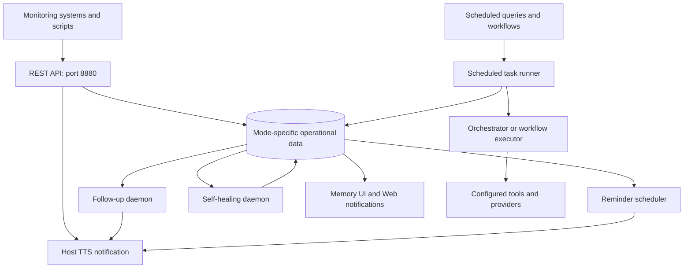

# Jarvis proactive assistant system

Jarvis receives events from external systems, stores alerts and reminders, and
runs background services that deliver notifications and scheduled work. Use it
to report a failed backup, announce a camera detection, remind you at a chosen
time, or run a recurring workflow.

For installation and the first alert, see the
[API setup guide](../api/READY_TO_USE.md). For service commands and configuration,
see [Background services](README.md).

## Overview

The main components have separate responsibilities:

| Component | What it does |
| --- | --- |
| REST API | Accepts requests from integrations and clients on port 8880. |
| Alert manager | Stores alerts, tracks their lifecycle, and requests host notifications. |
| Reminder scheduler | Finds due reminders and delivers their notifications. |
| Follow-up daemon | Re-notifies about pending alerts according to severity and follow-up limits. |
| Self-healing daemon | Checks configured recovery URLs and monitors supported services. |
| Scheduled task runner | Runs saved Jarvis queries and workflows and records each run's outcome. |
| Memory UI and Web notifications | Show saved alerts, reminders, and their state. |

The API and daemons are separate processes. The Web chat server is another
application; it uses the API for proactive notifications while normal chat has
its own orchestration path.

## Architecture



Notification delivery and scheduled execution have different costs. Delivering
an existing alert normally uses database access and TTS. A scheduled query or
workflow can call LLMs, tools, and external providers according to its definition.

## Alert lifecycle

An integration sends `POST /api/alerts` with a title and source, plus optional
severity, description, recovery URL, and metadata. Jarvis stores the alert and
returns its identifier. Notification behavior depends on its severity, source,
and the delivery path.

Pending alerts can receive follow-ups. An alert leaves the pending state when it
is acknowledged, cancelled, or auto-resolved through the applicable operation.
Exhausting the follow-up limit stops further follow-ups but does not mark the
alert acknowledged. Integrations with reviewed deduplication metadata can reuse
an existing pending alert; different events can remain separate alerts.

Recovery can be reported by the originating integration or detected from an
`auto_resolve_url`. A later successful job does not universally resolve earlier
failure alerts. See [Alert scenarios](../api/code-examples/ALERT_SCENARIOS.md) and the running
server's `/docs` for lifecycle endpoints.

## Reminders

A reminder's trigger time is the time Jarvis should notify you. Put a later
appointment or other event time in its title or description. For example, a noon
reminder can say that an appointment starts at 2 PM.

The reminder scheduler polls for due rows and records delivery state. Recurrence
and acknowledgement are handled by the reminder APIs and tools. The Memory UI
shows timing and lifecycle details. See the
[reminder guide](../api/REMINDER_SYSTEM.md) for request formats and supported operations.

## Scheduled tasks

Use a scheduled task to run a Jarvis query or deterministic workflow once or on
a recurring schedule. The runner records each attempt, summary, and error. This
is separate from a reminder, which delivers a notification without asking an LLM
to plan a new task.

Scheduled queries can use the normal orchestrator and model. Workflow tasks run
their defined tools, retries, and timeouts. Optional notifications can report the
outcome. See [Scheduled tasks](../tools/scheduled-tasks/scheduled-tasks.md).

## Configuration and data

API and service launchers select `cloud` by default or `local` with `--local`.
The corresponding mode file supplies configuration. Default operational data is
stored in `data/jarvis_memory.db` or `data/jarvis_memory_local.db`.

Start related processes in the intended mode. Provider choice is independent of
mode: cloud configuration can use different cloud providers, and local tools
can still require a network if enabled. Alerts, reminders, and scheduled tasks
remain separate between modes; the memory sync command does not copy them.
See [Dual databases](../DUAL_DATABASE_SYSTEM.md).

## Starting and operating services

```bash
# Start the daemons, then the API in cloud mode
./bin/jarvis-services
./bin/jarvis-api
```

The API stays in the foreground. Use a second terminal for status commands:

```bash
./bin/jarvis-api --status
./bin/jarvis-services --status
```

Use `--local` on the start commands for local mode. The normal stack launcher can
manage these components together; avoid starting duplicate processes.
The [service guide](README.md) documents stop/restart commands, watchdog recovery,
service logs, retention, and cleanup.

A stopped API cannot receive new integration requests. Existing daemons can
continue their database work while the API is unavailable. A stopped scheduler
cannot deliver reminders until it is running again. Recovery and notification
behavior therefore depend on which component is unavailable.

## Speech and browser notifications

Host notifications use the configured native speech scripts and playback
controls. Concurrent speech requests have separate processes; playback uses the
shared locking policy when available. This is distinct from browser TTS playback
and the browser's notification permission.

If an alert is saved but not heard, inspect its recorded speech state, TTS
configuration, and service logs. If a browser panel is stale, check API access and
its selected mode. See [Service logging](SERVICE_LOGGING.md) and
[Web UI](../JARVIS_WEB_UI.md).

## Background tool tasks and callbacks

Long-running Web tool jobs use the separate durable task system. A queued receipt
means the work was accepted, not completed. A callback integration must use the
task callback protocol; sending an ordinary alert is not a completion callback.
See [Background tasks](../BACKGROUND-TASKS.md) and
[Task callbacks](../TASK-CALLBACKS.md).

## Further reference

- [Service architecture FAQ](SERVICE_ARCHITECTURE_FAQ.md)
- [API documentation](../api/README.md)
- [Security and authentication](../SECURITY_HARDENING.md)
- [Testing guide](../TESTING.md)
