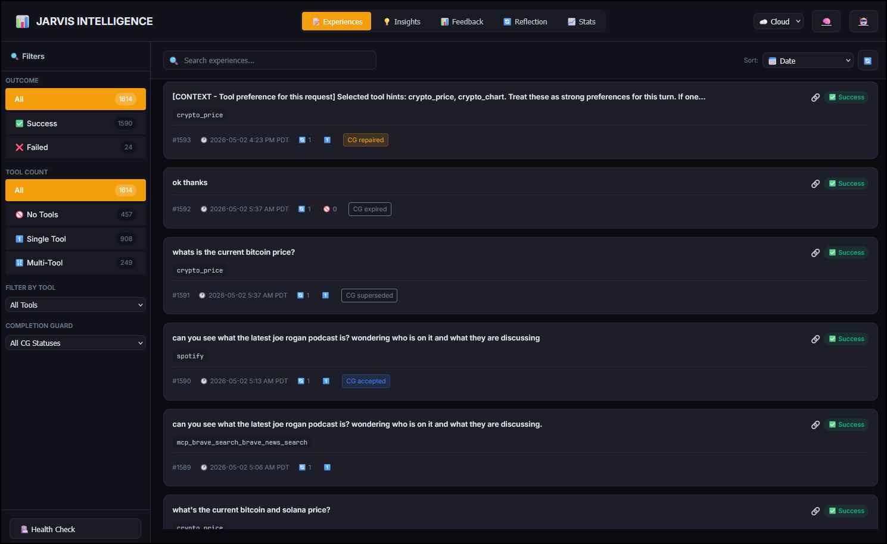

# Jarvis Intelligence Dashboard

📊 **Visual dashboard for Jarvis's self-learning system**

The Intelligence Dashboard provides a web interface to monitor, inspect, and manage Jarvis's learning capabilities - including experiences, insights, reflection queue, and meta-knowledge.



## Quick Start

```bash
# Start the dashboard
./bin/jarvis-intelligence

# Load auth/runtime settings from config/local.env
./bin/jarvis-intelligence local

# Or via the start script
./bin/start --ui-only          # Cloud/default: Web, Canvas, Memory, Intelligence, Docs
./bin/start --ui-only --local  # Same UI stack loading config/local.env

# Access at
http://localhost:5003
```

## Features

### 📝 Experiences Tab
- View all recorded interactions
- **Sort by**: Date, Turns (complexity), Tool Count, Completion Guard status
- **Filter by outcome**: All, Success, Failed
- **Filter by tool count**: All, No Tools (🚫), Single Tool (1️⃣), Multi-Tool (🔢)
- **Filter by specific tool**: Dropdown of all tools used
- **Filter by Completion Guard status**: Accepted, auto-accepted, repaired, ticketed, expired, superseded, or no guard
- Search experiences by query text
- View tool sequences and turn counts
- View configured-local time plus UTC time for stored UTC timestamps
- Inspect Completion Guard metadata and full stored raw experience JSON in the detail modal
- Enhanced cards show tool count badges and turn indicators
- Delete experiences or re-embed after edits

### 💡 Insights Tab
- Browse learned insights (what works and doesn't)
- Inspect preferred workflow IDs separately from generic preferred tools
- **Sort by**: Times Applied, Times Helpful, Has Preferred Tools, Has Avoided Tools, Confidence, Recently Updated
- **Filter by constraint type**:
  - ✅ **Positive** - "DO use this approach"
  - ❌ **Negative** - "DON'T use this approach"
- **5-tier confidence filtering**:
  - 💎 Elite (96-100%)
  - 🟢 High (85-95%)
  - 🟡 Good (75-84%)
  - 🟠 Medium (50-74%)
  - 🔴 Low (0-49%)
- **Differentiated confidence bars**: Green shades for positive, red/orange for negative constraints
- **Tool visibility**: Cards show preferred (👍) and avoided (👎) tools inline
- Insight timestamps display in the configured local timezone, with UTC shown in detail views
- Edit insight descriptions and patterns
- Re-embed after edits

### 🔄 Reflection Tab
- Scan compact pending rows with the user request, source, local time, tools,
  and priority; expand a row for the full request and one **Recorded answer**
- Search pending reflections and page through the complete queue
- Process one entry, the next five by priority, or up to twenty in groups of five
- Discard one pending reflection or use **☢️ Clear All** while retaining experiences
- View meta-knowledge findings:
  - Blind spots
  - Over-generalizations
  - Learning quality issues
- Run meta-cognition analysis

The source label identifies the entry point: Web, Voice, CLI, API, or Scheduled
task. Dashboard terminal commands use the CLI entry point. Older records without
reliable provenance show **Unknown source**; a stored Web conversation ID can establish
Web linkage. A session ID alone does not establish voice or CLI.

The expanded row shows the original request and one recorded answer, preferring
the saved raw response and falling back to the existing response text. Saved
excerpts are labeled. **Open experience** opens the existing Experience viewer
for deeper inspection; the queue does not duplicate logs or diagnostic panels.
Recognized legacy routing wrappers are removed for display without rewriting
historical records or embeddings.

Web Completion Guard repair calls retain the original user request and Web
source, while their existing learning-disabled policy prevents extra repair
experiences. Explicit workflow commands retain their existing recording bypass.

Only the original request and source are added to new experience metadata.
The queue does not collect extra conversation snapshots, tool payloads or
attachment excerpts, or add them to the reflection prompt. Priority controls
queue order rather than confidence in an insight.

Batch processing uses the selected mode's priority queue, including while search
is active. **Process 20** runs at most four requests of five, with progress and a
stop between groups. Each experience still gets its own reflection call. A
failure remains pending and is not repeatedly retried during the same run.
It keeps its priority and may be retried by a later click. Orphan queue entries
whose experiences no longer exist are settled without a model call and do not
consume an implicit batch slot. **Process one** reports such an entry as skipped.
Stopping or switching modes does not cancel an active model call; it prevents
subsequent groups from starting. Completed reflections remain saved.

Processing and discarding are explicit actions. Opening or expanding the queue
does not run the reflection model. Discarding removes only pending queue entries;
experience deletion remains a separate action in the Experience detail view.
Dashboard and main API processing, pending-entry cancellation and dashboard
experience deletion coordinate through the same database-side file lock. Busy
requests return HTTP 409; a worker exit releases the lock. This covers runtime
routes; offline cleanup, destructive sync and database restoration still require
exclusive operator access.

### 📈 Stats Tab
- Experience totals and success rates
- Insight counts by constraint type
- Confidence distribution
- Application stats (times applied, helpfulness)
- Optional lifetime Completion Guard summary, including repaired count and status breakdown when guard history exists
- **Tool performance table** - Shows ALL tools (prefer vs avoid counts, net score)
- Maintenance actions (decay, anomaly, meta-cognition)

### 📊 Feedback Tab
- View all feedback from `logs/feedback/` in a friendly UI format
- **Sort by**: Date (newest first)
- **Filter by rating**: All, Issues (1-3), Good (4-5)
- **Filter by time**: 7, 30, 90 days
- **Stats bar**: Average rating, total entries, issue rate percentage
- **Feedback cards** show:
  - Star rating (1-5) with color coding (green=good, red=issues)
  - Original query text
  - AI-generated summary
  - Tool badges for tools used
  - Timestamp
- **Click to expand** detailed modal with:
  - Full query and rating
  - Summary and positive comments
  - Detailed issues with category, description, and suggestions
  - Tool-specific ratings with individual scores
  - Response preview (truncated)
  - Metadata (session, message ID, mode, duration)
- Search feedback by query text
- No more terminal/log file browsing required

## API Endpoints

`GET /api/status` reports the server's `startup_mode` and both database paths.
The URL `?mode=`, saved browser preference, and then `startup_mode` determine
the initial data selector. A pristine selected-mode DB is initialized through
the canonical Intelligence schema owner before serving requests.

### Experiences
| Method | Endpoint | Description |
|--------|----------|-------------|
| GET | `/api/experiences?mode={cloud\|local}` | List experiences |
| GET | `/api/experiences/<id>` | Get single experience |
| GET | `/api/experiences/search?q=<query>` | Search experiences |
| PUT | `/api/experiences/<id>` | Update experience |
| DELETE | `/api/experiences/<id>` | Delete experience |
| POST | `/api/experiences/<id>/reembed` | Re-embed after edit |

### Insights
| Method | Endpoint | Description |
|--------|----------|-------------|
| GET | `/api/insights?mode={cloud\|local}` | List insights |
| GET | `/api/insights/<id>` | Get single insight |
| GET | `/api/insights/search?q=<query>` | Search insights |
| PUT | `/api/insights/<id>` | Update insight |
| DELETE | `/api/insights/<id>` | Delete insight |
| POST | `/api/insights/<id>/reembed` | Re-embed after edit |
| GET | `/api/insights/tool-performance` | Tool preference stats |

### Stats & Maintenance
| Method | Endpoint | Description |
|--------|----------|-------------|
| GET | `/api/stats` | Comprehensive statistics |
| GET | `/api/stats/reflection-queue` | Searchable, paginated pending reflections and total counts |
| GET | `/api/stats/reflection-queue/<id>` | Review the full request and one recorded answer |
| DELETE | `/api/stats/reflection-queue/<id>` | Discard one pending reflection, retaining its experience |
| DELETE | `/api/stats/reflection-queue` | Clear pending reflections in the selected mode |
| GET | `/api/stats/meta-knowledge` | Meta-knowledge findings |
| POST | `/api/maintenance/reflect?batch_size=5` | Process a priority chunk (1–20), JSON `reflection_id`, or JSON `reflection_ids` (up to five queue IDs) |
| POST | `/api/maintenance/decay` | Run decay job |
| POST | `/api/maintenance/anomaly` | Run anomaly detection |
| POST | `/api/maintenance/meta-cognition` | Run meta-cognition |
| POST | `/api/maintenance/all` | Run all maintenance |
| GET | `/api/maintenance/health` | Health check |

### Feedback
| Method | Endpoint | Description |
|--------|----------|-------------|
| GET | `/api/feedback?days=30&rating_max=3&limit=100` | List feedback entries with filters |
| GET | `/api/feedback/stats?days=30` | Aggregated feedback statistics |
| GET | `/api/feedback/files` | List available feedback log files |

**Filter parameters for `/api/feedback`:**
- `days` - Number of days to look back (default: 30)
- `rating_max` - Max rating filter (e.g., 3 for issues only)
- `rating_min` - Min rating filter (e.g., 4 for good only)
- `mode` - Filter by mode (cloud/local)
- `limit` - Max entries to return (default: 100)

## Mode Switching

Like other Jarvis dashboards, use the mode selector to switch between:
- **☁️ Cloud** - `data/jarvis_intelligence.db` (Ollama Jarvis Embedding, 768D)
- **💻 Local** - `data/jarvis_intelligence_local.db` (Ollama embeddings, 768-dim)

**Note**: Embedding dimensions are incompatible between modes.

## Re-Embedding After Edits

When you edit an insight or experience, the semantic embeddings become stale. Use the re-embed button or CLI:

```bash
# Re-embed an insight
./bin/re-embed-insight <id>
./bin/re-embed-insight <id> local   # For local mode

# Re-embed an experience
./bin/re-embed-experience <id>
./bin/re-embed-experience <id> local
```

## Architecture

```
jarvis-intelligence/
├── server/
│   ├── app.py                    # Flask application
│   ├── routes/
│   │   ├── experiences.py        # Experience CRUD
│   │   ├── insights.py           # Insight CRUD + re-embed
│   │   ├── stats.py              # Statistics endpoints
│   │   ├── maintenance.py        # Maintenance job triggers
│   │   └── feedback.py           # Feedback log viewer
│   └── services/
│       └── intelligence_service.py  # Database operations
├── client/
│   ├── index.html               # Main UI (5 tabs)
│   ├── css/
│   │   ├── variables.css        # Theme variables (amber accent)
│   │   └── intelligence.css     # Styles + responsive + feedback
│   └── js/
│       ├── api.js               # API client (incl. feedback methods)
│       └── app.js               # UI logic (incl. feedback rendering)
└── requirements.txt
```

## Cross-UI Navigation

From the Intelligence Dashboard header:
- 🧠 → Memory Browser (port 5002)
- 🤖 → Jarvis Web UI (port 5001)

From other dashboards:
- Jarvis Web: 📊 → Intelligence Dashboard
- Memory Browser: 📊 → Intelligence Dashboard

## Mobile Support

The dashboard is fully responsive:
- Hamburger menu for filters below 730px
- Collapsible sidebar
- Touch-friendly cards and buttons
- Adjusted layouts for small screens

## Dashboard Integration

The Intelligence Dashboard is integrated into `jarvis-dashboard` TUI:

```bash
# From jarvis-dashboard under "🧠 Intelligence":
- Start Intelligence UI
- Intelligence UI Health
- Open Intelligence UI
- Intel Health
- Run All Maintenance
- etc.
```

## Database Schema

### Experiences Table
- Query text and embeddings
- Tools used (JSON array)
- Outcome success/failure
- Turn count
- Timestamps

### Insights Table
- Description and pattern
- Constraint type (positive/negative)
- Preferred/avoided tools (JSON)
- Confidence score
- Application tracking

### Meta Knowledge Table
- Blind spots
- Over-generalizations
- Learning quality findings

See `docs/INTELLIGENCE_LAYER.md` for complete documentation.

---

**Port**: 5003  
**Dependencies**: Flask, Flask-CORS  
**Related**: `lib/intelligence.py`, `lib/intelligence_hooks.py`
